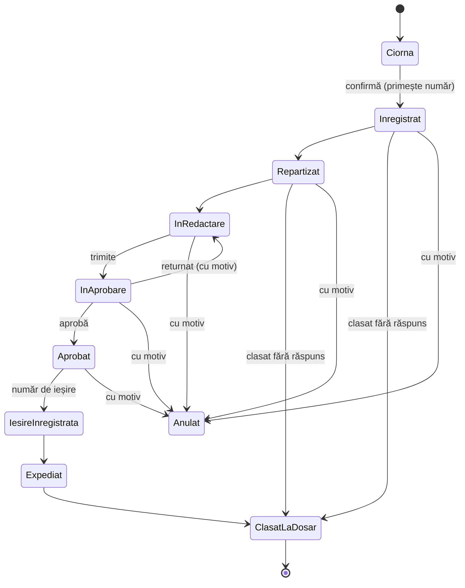

# BRD v2 — Registratură și evidența deșeurilor pentru ADI

Nov 11, 2026 · @Ionut

## Controlul documentului

Versiunea 2.2 adaugă beneficiarul real, demo-ul cu server, modelul conceptual de date, setul de date demo și etapele de livrare și este propusă spre aprobare pentru domeniul demo. Pentru exploatare reală, ipotezele marcate **„Ipoteză demo — de confirmat”** trebuie confirmate de beneficiar.

| Versiune | Modificări | Stare |
| --- | --- | --- |
| 2.2 | Beneficiar real (ADI Eco Buzău 2009) și legătura cu art. 5 lit. g¹ din statut; demo cu server și bază de date; model conceptual de date; set de date demo pe 7 UAT-uri reale; etape de livrare; ipoteze I16–I17 | În aprobare |
| 2.1 | Autentificare cu parolă și 2FA (TOTP, cod QR, coduri de recuperare); secțiune de accesibilitate (WCAG 2.1 AA); ipoteze I14–I15 | Înlocuită |
| 2.0 | Corecții de citare; condiții legale adăugate la D02 și D03; nomenclator arhivistic; dicționar de date; stări; matrice de acces; reguli de numerotare; cerințe nefuncționale; trasabilitate; ipoteze și întrebări | Înlocuită |
| 1.0 | Versiune inițială (document de cerințe de business / demo, 4 pagini) | Înlocuită |

**Aprobări necesare:** responsabilul de produs pentru domeniul demo; reprezentantul ADI pentru ipotezele marcate.

## Context, beneficiar și scop

Aplicația web ajută o asociație de dezvoltare intercomunitară (ADI) să țină evidența documentelor intrate, interne și ieșite și să urmărească cantitățile de deșeuri raportate pe fiecare UAT membră.

**Beneficiar țintă:** Asociația de Dezvoltare Intercomunitară „Eco Buzău 2009”, care acționează în numele UAT-urilor membre pentru serviciul de salubrizare. Caietul de sarcini din 2025 numește aproximativ 84 de UAT-uri delegatare: municipiul Râmnicu Sărat, orașele Nehoiu, Pătârlagele și Pogoanele și comunele membre. Municipiul Buzău nu este delegatar. Identitatea, mandatul și contractele se confirmă înainte de exploatare (vezi Ipoteze demo și întrebări).

**De ce acum:** proiectul de act adițional la statut (decembrie 2025) adaugă la art. 5 alin. (1) litera g¹: asociația elaborează și implementează procedura de control și verificare a respectării drepturilor și obligațiilor operatorilor și utilizatorilor. Modulul de deșeuri (verificarea raportului operatorului față de tichete, semnalările, urmărirea fiecărei cifre până la dovezi) este instrumentul pentru această procedură.

**Statut juridic relevant:** ADI-ul este persoană juridică de drept privat și de utilitate publică. Din acest motiv, unele obligații scrise pentru autorități și instituții publice (petiții, informații de interes public) sunt marcate „Condiționată”.

| Componentă | Ce poate face utilizatorul |
| --- | --- |
| Registratură | Înregistrează un document, îl repartizează, pregătește și aprobă răspunsul, înregistrează ieșirea, consemnează expedierea și clasează documentul la dosar. |
| Evidența deșeurilor | Importă raportul operatorului, verifică tichetele și atribuirea pe UAT, validează și aprobă totalurile anuale. Consultă datele pentru PAYT și o estimare explicată a contribuției la Fondul pentru mediu. |

### Cum citim statutul unei cerințe

- **Legală** — obligație prevăzută de actul citat.
- **Condiționată** — se aplică doar dacă sunt îndeplinite condițiile legale sau contractuale indicate.
- **De produs** — funcție propusă de noi, opțională din perspectiva legii, inclusă în demo când ajută scenariul.
- **Ipoteză demo — de confirmat** — regulă aleasă pentru demo acolo unde decizia aparține beneficiarului. Fiecare are un cod (I01…) în secțiunea de ipoteze.

Fiecare cerință descrie separat ce se întâmplă **în demo** și ce se cere **în exploatare**.

## Domeniu

Demo-ul acoperă circuitul complet al unui document și al unui raport de deșeuri, pe un server de demo găzduit în UE, cu date fictive construite pe UAT-uri reale. Integrările externe și semnătura sunt simulate sau excluse.

**În domeniu (demo)**

- Server de demo cu bază de date, găzduit în UE, și set de date demo pe 7 UAT-uri membre reale (vezi Setul de date demo).
- Registru unic anual pentru intrări, ieșiri și documente interne, cu fișe, anexe și istoric.
- Repartizare, redactare, aprobare sau returnare motivată, înregistrarea ieșirii, expediere simulată, clasare la dosar.
- Nomenclator arhivistic simplificat (indicativ dosar, termen de păstrare) și închiderea anului.
- Import CSV al raportului operatorului, verificări automate, corectare, validare și aprobare anuală.
- Centralizator pe UAT, date pentru PAYT și estimarea contribuției AFM, cu formula vizibilă.
- Autentificare cu parolă și 2FA prin cod QR (TOTP), coduri de recuperare, resetarea 2FA.
- Accesibilitate la nivel WCAG 2.1 AA pe toate ecranele.
- Export CSV, imprimarea fișei, resetarea datelor demo.

**În afara domeniului (demo)**

- Găzduire de producție: copii de siguranță automate, monitorizare, plan de continuitate, test de penetrare.
- SSO, recuperarea contului prin e-mail sau SMS, 2FA prin SMS.
- Semnătură electronică și sigiliu.
- Expediere reală (e-mail, curier, poștă) și primire automată din e-mail.
- Integrare cu SIATD, AFM, ANRSC, ANPM sau cu sistemele operatorului.
- Calculul efectiv al taxei de salubrizare pe UAT (doar datele sunt pregătite).
- Depunerea declarației la AFM.
- Arhivă electronică conform unui sistem aprobat de Arhivele Naționale.
- Codurile SIRUTA reale (în demo se folosesc coduri demo, I17).
- Declarația de accesibilitate publicată (doar în exploatare, dacă se aplică).

## Glosar

| Termen | Înțeles în acest document |
| --- | --- |
| 2FA | Autentificare în doi pași: parolă plus un cod de unică folosință |
| ADI | Asociație de dezvoltare intercomunitară cu obiect serviciul de salubrizare |
| AFM | Administrația Fondului pentru Mediu |
| Anexă | Fișier atașat unei fișe de document |
| Aplicație de autentificare | Aplicație de pe telefon care generează coduri TOTP (ex. Google Authenticator, Microsoft Authenticator) |
| Cod de recuperare | Cod de unică folosință care înlocuiește codul 2FA când telefonul nu este disponibil |
| Cod LER | Codul deșeului din Lista europeană a deșeurilor, format „NN NN NN” (ex. 20 03 01) |
| Dosar | Unitate arhivistică definită în nomenclator, cu indicativ și termen de păstrare |
| EN 301 549 | Standardul european de accesibilitate pentru produse și servicii TIC; pentru web preia WCAG 2.1 AA |
| Fișa documentului | Ecranul cu toate datele, anexele și istoricul unui document înregistrat |
| Nomenclator arhivistic | Lista dosarelor ADI-ului, cu indicativ și termen de păstrare |
| PAYT | Instrumentul economic „Plătește pentru cât arunci” |
| Rută comună | Cursă de colectare care trece prin mai multe UAT-uri |
| SIATD | Sistemul informatic de asigurare a trasabilității deșeurilor |
| SIRUTA | Codul oficial al unei unități administrativ-teritoriale |
| Tichet de cântar | Dovada cântăririi unei curse la instalația de destinație |
| TOTP | Cod de unică folosință bazat pe timp (RFC 6238), schimbat la 30 de secunde |
| UAT | Unitate administrativ-teritorială membră a ADI-ului |
| WCAG | Ghidul W3C pentru accesibilitatea conținutului web; nivelul țintă este 2.1 AA |

## Roluri și matricea de acces

Demo-ul are trei utilizatori fictivi, câte unul pe rol, fiecare cu cont propriu, parolă și 2FA; schimbarea utilizatorului înseamnă deconectare și o nouă autentificare. Matricea de mai jos este regula de autorizare: orice acțiune care nu apare cu „Da” este interzisă și ascunsă din interfață.

| Rol | Responsabilitate |
| --- | --- |
| Ana — Registrator | Ține registrul: înregistrează, repartizează, înregistrează ieșirea, consemnează expedierea, clasează la dosar |
| Mihai — Responsabil ADI | Redactează răspunsuri pentru lucrările primite; importă, verifică, corectează și validează datele de deșeuri |
| Elena — Director | Aprobă sau returnează răspunsuri; aprobă totalurile anuale de deșeuri; redeschide perioade |

### Registratură

| Acțiune | Ana | Mihai | Elena |
| --- | --- | --- | --- |
| Vede registrul complet | Da | Nu, doar lucrările repartizate lui | Da |
| Vede fișa, anexele, istoricul | Da | Doar lucrările repartizate lui | Da |
| Înregistrează document (ciornă și confirmare) | Da | Nu | Nu |
| Repartizează / reasignează | Da | Nu | Da |
| Corectează metadate după confirmare, cu motiv | Da | Nu | Nu |
| Anulează o înregistrare, cu motiv | Da | Nu | Nu |
| Redactează răspuns | Nu | Da, pe lucrările sale | Nu |
| Trimite răspunsul la aprobare | Nu | Da | Nu |
| Aprobă sau returnează motivat | Nu | Nu | Da |
| Prelungește termenul, cu motiv | Nu | Nu | Da |
| Înregistrează ieșirea și expedierea | Da | Nu | Nu |
| Clasează la dosar | Da | Nu | Nu |
| Gestionează nomenclatorul, închide anul | Da | Nu | Da (aprobă închiderea) |
| Export CSV, imprimare fișă | Da | Doar lucrările sale | Da |

### Evidența deșeurilor

| Acțiune | Ana | Mihai | Elena |
| --- | --- | --- | --- |
| Înregistrează raportul operatorului ca intrare | Da | Nu | Nu |
| Importă CSV, leagă importul de intrare | Nu | Da | Nu |
| Corectează, exclude, atribuie rânduri | Nu | Da | Nu |
| Validează rânduri | Nu | Da | Nu |
| Aprobă totalul anual pe UAT | Nu | Nu | Da |
| Redeschide un an aprobat, cu motiv | Nu | Nu | Da |
| Gestionează datele UAT (SIRUTA, mediu, populație, cantitate contractată) | Nu | Da | Da (aprobă) |
| Consultă centralizatorul și estimarea AFM | Nu | Da | Da |
| Exportă centralizatorul | Nu | Da | Da |

**Separarea atribuțiilor:** cine corectează și validează rândurile (Mihai) nu aprobă totalul anual folosit la PAYT și AFM (Elena).

**În exploatare:** permisiunile se confirmă de beneficiar (I07); aceeași persoană nu poate deține simultan rolurile de responsabil și director.

## Autentificare și 2FA

Fiecare utilizator se autentifică cu parolă și cu un cod de 6 cifre generat de o aplicație de autentificare de pe telefon. La prima autentificare, aplicația afișează un cod QR pe care utilizatorul îl scanează o singură dată.

**Parametri TOTP** (RFC 6238): SHA-1, 6 cifre, pas de 30 de secunde, secret aleator de 160 de biți. Sunt compatibili cu aplicațiile uzuale (Google Authenticator, Microsoft Authenticator și altele).

| ID · statut | Cerință | În demo | În exploatare |
| --- | --- | --- | --- |
| S01 · De produs | Autentificare cu parolă | Trei conturi demo; parolele fictive sunt afișate pe ecranul de autentificare | Parole proprii, stocate ca hash (Argon2id sau bcrypt); politică de parole |
| S02 · De produs \[3\] | Înrolare 2FA cu cod QR | La prima autentificare, după parolă, se generează secretul și se afișează codul QR (`otpauth://totp/ADI Demo:<utilizator>`) plus cheia în text, pentru introducere manuală. Contul devine activ doar după introducerea unui cod valid | Secretul se generează și se păstrează criptat pe server; nu mai este afișat după înrolare |
| S03 · De produs \[3\] | Autentificare cu cod | După parolă se cere codul. Se acceptă codul pasului curent și ±1 pas, pentru decalajul de ceas. Un cod folosit nu mai este acceptat a doua oară | La fel, verificat pe server; 2FA obligatoriu pentru toate rolurile (I14) |
| S04 · De produs | Coduri de recuperare | La înrolare se generează 10 coduri de unică folosință, afișate o singură dată, cu opțiune de imprimare sau descărcare | Stocate ca hash |
| S05 · De produs | Limitarea încercărilor | După 5 coduri greșite consecutive, contul se blochează 5 minute | La fel, plus alertă către administrator |
| S06 · De produs | Resetarea 2FA | Elena poate reseta 2FA pentru alt utilizator, cu motiv; la următoarea autentificare utilizatorul se reînrolează (I14) | Administrator dedicat, cu verificarea identității |
| S07 · De produs | Sesiune | Deconectare manuală și automată după 30 de minute de inactivitate, cu avertizare și opțiune de prelungire cu 2 minute înainte | La fel; cookie de sesiune securizat |
| S08 · De produs \[3\] | Jurnal de securitate | Se înregistrează autentificările reușite și eșuate, înrolările, resetările și folosirea codurilor de recuperare | La fel, cu adresa IP |

**Limită a demo-ului:** parolele și codurile 2FA se verifică pe server, deci fluxul este real. Serverul de demo nu are însă măsurile de securitate ale exploatării (copii de siguranță, monitorizare, test de penetrare), iar conturile sunt doar cele trei conturi demo.

### Scenariu de acceptare — autentificare

1. Ana se autentifică prima dată cu parola; aplicația afișează codul QR și cheia în text.
2. Ana scanează codul cu aplicația de pe telefon, introduce codul de 6 cifre și primește 10 coduri de recuperare.
3. Ana se deconectează și se autentifică din nou cu parolă și cod; codul QR nu mai apare.
4. Mihai introduce 5 coduri greșite; contul se blochează 5 minute, iar jurnalul arată încercările.
5. Mihai folosește un cod de recuperare; același cod este refuzat la a doua folosire.
6. Elena resetează 2FA pentru Mihai, cu motiv; la următoarea autentificare, Mihai primește un cod QR nou.

## Registratură — cerințe

Obligația centrală este evidența documentelor intrate, întocmite pentru uz intern și ieșite, grupate anual în dosare. Criteriile de acceptare pentru fiecare cerință sunt în secțiunea Trasabilitate.

| ID · statut | Cerință | În demo | În exploatare |
| --- | --- | --- | --- |
| R01 · Legală \[1\] | Evidența documentelor intrate, interne și ieșite | Toate trei categoriile se înregistrează în același registru și rămân după reîncărcarea paginii | La fel, pe server, cu copii de siguranță |
| R02 · Legală \[1\] | Documente electronice: integritate, autenticitate, acces și modificare controlate, identificabile și databile, export conform sistemului aprobat | Anexa originală nu se modifică. Orice corecție păstrează valoarea veche și nouă, autorul, data și motivul într-un jurnal care doar se completează | Sistem de management arhivistic aprobat de Arhivele Naționale; formate agreate pentru păstrare permanentă |
| R03 · Legală \[1\] | Nomenclator arhivistic și grupare anuală în dosare | Nomenclator cu 5 dosare exemplu (I04). Clasarea cere dosar. Fișa arată indicativul și termenul de păstrare. Închiderea anului blochează clasarea în anul închis | Nomenclatorul aprobat al ADI-ului; predarea la arhivă pe bază de inventar |
| R04 · Condiționată \[2\] | Termene de răspuns, dacă OG 27/2002 sau Legea 544/2001 se aplică ADI-ului (I03) | Termenul se calculează din data înregistrării, după tipul cererii: petiție 30 de zile; informații de interes public 10 zile; altele, termen intern de 30 de zile. Directorul poate prelungi cu motiv (petiții: maximum 15 zile). Atenționare cu 5 zile înainte de termen. Petițiile greșit îndreptate se marchează „redirecționat”, cu termen de 5 zile | Tipurile și termenele confirmate de beneficiar |
| R05 · Legală \[3\] | Prelucrarea datelor personale: minimizare, protecție din proiectare, securitate | Doar date fictive. Fișa cere doar numele și adresa corespondentului; CNP-ul nu se colectează | Acces după rol, jurnal de acces, criptare, termene de ștergere, informare GDPR |
| R06 · De produs | Număr și legături | Numărul se atribuie la confirmare, o singură dată (vezi Numerotare). Referința expeditorului se păstrează separat. Răspunsul se leagă de intrare; fișa arată starea, data, canalul și dovada expedierii | La fel |
| R07 · De produs | Lucru pe roluri | Aplică matricea de acces în listă, căutare, fișă, export și link direct. O lucrare nerepartizată lui Mihai nu apare și nu se deschide pentru el | Autentificare reală; roluri configurabile |
| R08 · De produs | Căutare, filtre, export, imprimare | Căutare după număr intern sau extern, obiect, corespondent; filtre pe sens, stare, responsabil, termen, dosar. Exportul CSV conține exact lista filtrată. Fișa se imprimă pe A4. Resetarea restaurează datele fictive | La fel, fără resetare |
| R09 · De produs | Expediere | Se consemnează canalul (e-mail, poștă, curier, predare directă), data și o dovadă simulată (fișier sau număr de confirmare) | Dovada reală a expedierii, atașată |

## Registratură — numerotare și stări

Numărul de înregistrare se atribuie o singură dată, la confirmare, și nu se reutilizează niciodată.

### Reguli de numerotare

1. **Registru unic anual** pentru intrări, ieșiri și documente interne, cu o singură serie continuă, format `nr/an` (ex. 121/2026). Ipoteză demo — de confirmat (I01).
2. **Resetare anuală:** primul document confirmat după 1 ianuarie (ora României) primește numărul 1.
3. **Ciornele nu au număr.** O ciornă ștearsă nu lasă gol în registru.
4. **Anulare:** o înregistrare confirmată se poate anula doar cu motiv. Numărul rămâne în registru, marcat „Anulat”, și nu se reatribuie.
5. **Răspunsul** primește un număr nou de ieșire și se leagă de intrare. Alternativa (răspuns înregistrat la numărul intrării) se decide de beneficiar (I02).
6. **Unicitate:** două confirmări simultane nu pot primi același număr. Numărul se alocă atomic pe server, într-o tranzacție, inclusiv în demo.
7. **Referința expeditorului** (ex. 438/2026) se păstrează într-un câmp separat și nu influențează numerotarea.

### Stările unui document


*(Diagrama stărilor unui document — 9 stări principale, o buclă de returnare, plus ieșirile „Anulat” și „Clasat fără răspuns”.)*

Un răspuns returnat se întoarce în redactare, cu motivul vizibil în istoric. Două ieșiri din fluxul principal:

- **Anulat** — din orice stare până la „Ieșire înregistrată”, de către registrator, cu motiv.
- **Clasat fără răspuns** — din „Înregistrat” sau „Repartizat”, pentru documentele care nu cer răspuns (ex. rapoartele operatorului), cu dosar obligatoriu.

Documentele interne urmează același flux fără expediere.

## Registratură — ecrane și scenariu de acceptare

Circuitul se demonstrează pe patru ecrane, cu documente fictive.

| Ecran | Conținut și acțiuni |
| --- | --- |
| Registrul documentelor | Lista filtrată după rol; căutare; filtre pe sens, stare, responsabil, termen, dosar; termenele depășite sau apropiate evidențiate; export CSV |
| Înregistrare document | Sens, dată, corespondent, număr extern, obiect, categorie, tip cerere (determină termenul), canal, anexe; salvare ciornă și confirmare |
| Fișa documentului | Număr, stare, responsabil, termen, dosar și termen de păstrare, anexe, documente legate, istoric complet, ciornă de răspuns, aprobare, număr de ieșire, expediere; imprimare A4 |
| Nomenclator și an | Lista dosarelor (indicativ, denumire, termen de păstrare); închiderea anului |

### Scenariu de acceptare — registratură

1. Ana înregistrează adresa externă 438/2026 ca intrare 121/2026, tip „petiție”; termenul afișat este data înregistrării + 30 de zile.
2. Ana o repartizează lui Mihai. Lucrarea apare în lista lui Mihai; o altă intrare, nerepartizată, nu apare și nu se deschide prin link direct.
3. Mihai redactează o cerere de clarificări și o trimite la aprobare.
4. Elena o returnează cu motivul „Completați temeiul legal”. Mihai corectează și retrimite. Elena aprobă.
5. Ana înregistrează ieșirea 122/2026, legată de intrarea 121/2026, și consemnează expedierea prin e-mail, cu dovadă simulată.
6. Ana clasează ambele documente în dosarul „Corespondență cu UAT-urile”.
7. Căutarea după 438/2026 găsește intrarea, răspunsul și istoricul, inclusiv returnarea cu motiv.
8. Ana corectează obiectul intrării cu motiv; istoricul arată valoarea veche și cea nouă, autorul și data.

## Evidența deșeurilor — cerințe

Responsabilul ADI prelucrează raportul operatorului și documentele justificative; directorul aprobă totalurile anuale și poate urmări orice cifră până la rândurile și tichetele care o susțin.

| ID · statut | Cerință | În demo | În exploatare |
| --- | --- | --- | --- |
| D01 · Legală \[4\] | UAT-urile sau ADI-ul, după caz, aplică PAYT și ating țintele de pregătire pentru reutilizare și reciclare: 55% (2025), 60% (2030), 65% (2035) | Cantitățile pe fracții și indicatorul de reciclare se afișează separat, cu baza de calcul vizibilă și ținta anului ca reper | Indicatorul calculat după metodologia ANPM, pe date raportate |
| D02 · Condiționată \[5\] | Dacă ADI-ul a încheiat delegarea și plata se face prin taxă, ADI-ul calculează factorii de ajustare și taxa pe UAT, pe baza cantităților colectate anual, fără a modifica cantitatea totală contractată (urban/rural) | Se pregătesc datele: cantitate anuală aprobată pe UAT, mediu, populație, cantitate contractată. Se afișează comparația cu totalul contractat. Calculul taxei este dezactivat | Calculul se activează după validarea regulilor și a contractului (I13) |
| D03 · Condiționată \[6\] | Când obiectivul anual de reducere a depozitării nu e îndeplinit, UAT-ul datorează 50 lei/t pe diferență; declarare și plată anuală până la 25 ianuarie | Estimare anuală pe UAT, cu formula afișată (vezi Reguli de calcul), distinctă de ținta de reciclare și de PAYT. Mesaj cu termenul de 25 ianuarie | Datele susțin declarația UAT-ului; ADI-ul nu este plătitor |
| D04 · Context \[7, 8\] | Formularul de încărcare-descărcare și raportarea în SIATD revin transportatorului; transportul municipal al operatorului de salubrizare este exceptat de HG 1061/2008 (art. 23 alin. 1), dar nu și transportul propriilor deșeuri (alin. 2) | Tichetele și formularele operatorului se atașează ca dovezi la rânduri. ADI-ul nu raportează în SIATD | Se verifică rolul fiecărei entități în flux |
| D05 · De produs | Import CSV legat de registratură | Fiecare import se leagă obligatoriu de numărul de intrare al raportului operatorului. Fișierul respectă dicționarul de date; rândurile invalide se raportează cu motiv, fără a bloca restul | Import și din fișierele standard ale operatorului, după mapare |
| D06 · De produs | Verificări și atribuire pe UAT | Se semnalează duplicatele, diferențele de cantitate și originea neconfirmată (reguli V1–V6). Rutele comune se atribuie doar pe bază de dovezi sau după o regulă aprobată de director (I09) | La fel |
| D07 · De produs | Validare, aprobare anuală, închidere | Mihai validează rândurile; Elena aprobă totalul anual pe UAT, care blochează rândurile anului. Redeschiderea cere motiv | La fel |
| D08 · De produs | Centralizator pe UAT | Filtre pe UAT, perioadă, fracție, destinație. Totalurile includ doar rânduri validate; cele nevalidate, excluse sau neatribuite apar separat. Orice total se deschide până la rânduri și tichete. Exportul conține rezultatele filtrate | La fel |

## Dicționarul de date pentru import

Un rând din CSV reprezintă o cursă cântărită. Fișierul este UTF-8 (BOM acceptat), cu separator `;`, zecimale cu virgulă și primul rând cu numele exacte ale câmpurilor (I10).

| Câmp | Tip și format | Obligatoriu | Exemplu |
| --- | --- | --- | --- |
| perioada | Lună, `AAAA-LL` | Da | 2026-03 |
| data\_cantaririi | Dată și oră, `AAAA-LL-ZZ HH:MM`, ora României; în perioada raportată | Da | 2026-03-14 09:42 |
| nr\_tichet | Text, maximum 30 caractere | Da | T-004512 |
| nr\_auto | Text, număr de înmatriculare | Da | BZ-12-ABC |
| operator\_cui | Cifre, fără prefixul RO | Da | 12345678 |
| uat\_siruta | Cod SIRUTA al unei UAT membre | Nu; gol = origine neconfirmată | 900001 (fictiv) |
| ruta\_comuna | `Da` / `Nu` | Da | Nu |
| uat\_ruta | Coduri SIRUTA separate prin `\|` | Doar dacă ruta\_comuna = Da | 900001\|900002 |
| cod\_ler | Text, format `NN NN NN` | Da | 20 03 01 |
| fractie | Valoare din listă: reziduale, hârtie-carton, plastic-metal, sticlă, biodeșeuri, voluminoase, altele | Da | reziduale |
| destinatie\_tip | Valoare din listă: sortare, TMB, compostare, reciclare, altă valorificare, depozitare | Da | depozitare |
| instalatie\_destinatie | Text | Da | Depozit conform (fictiv) |
| cantitate\_raportata\_t | Zecimal în tone, > 0, maximum 3 zecimale | Da | 7,240 |
| cantitate\_tichet\_t | Zecimal în tone, de pe tichet | Nu | 7,220 |
| document\_justificativ | Text, referința avizului sau a documentului | Nu | AV-2026-118 |

**Date de referință pe UAT** (întreținute în aplicație, nu în CSV): cod SIRUTA, denumire, mediu (urban/rural), populație, serviciu de salubrizare organizat (Da/Nu), cantitate contractată anual (t).

### Reguli de verificare

Fiecare rând trece prin regulile de mai jos la import. Un rând semnalat nu intră în totalurile validate până nu este rezolvat.

| Regulă | Condiție | Rezultat |
| --- | --- | --- |
| V1 Format | Lipsește un câmp obligatoriu, tip greșit sau valoare în afara listei | Rând respins, cu motiv în raportul de import |
| V2 Duplicat | Aceeași combinație operator\_cui + nr\_tichet + data\_cantaririi apare de două ori în fișier sau există deja în sistem | A doua apariție: semnalată „Duplicat” |
| V3 Diferență de cantitate | \|cantitate\_raportata\_t − cantitate\_tichet\_t\| > 0,020 t (I08) | Semnalat „Diferență”, cu valorile alăturate |
| V4 Origine neconfirmată | uat\_siruta gol, sau ruta\_comuna = Da fără dovadă sau regulă aprobată | Semnalat „Neatribuit” |
| V5 UAT necunoscut | Codul SIRUTA nu este al unei UAT membre | Semnalat „UAT necunoscut” |
| V6 Perioadă închisă | Anul rândului are totalul aprobat pentru acea UAT | Rând respins |

## Reguli de calcul

Toate calculele folosesc doar rânduri validate din ani aprobați sau, în previzualizare, rânduri validate din anul curent, marcate „provizoriu”. Formula și valorile intrării se afișează lângă fiecare rezultat.

### Estimarea contribuției AFM (D03)

Cantitatea aferentă obiectivului se obține aplicând procentul din anexa 6 la cantitatea de deșeuri municipale colectată din UAT în anul respectiv (I05, I06):

```latex
Q_{ob} = p_{anexa\,6} \cdot Q_{mun}
```

Cantitatea eligibilă este suma rândurilor aprobate cu destinația sortare (fracții colectate separat), reciclare, compostare sau altă valorificare (I12):

```latex
C = \max(0,\; Q_{ob} - Q_{val}) \cdot 50\ \text{lei/t}
```

Pentru o UAT care nu a organizat serviciul de salubrizare, contribuția se calculează pe întreaga cantitate estimată (I11):

```latex
Q_{est} = 0{,}233 \cdot P_{urban} + 0{,}105 \cdot P_{rural} \quad [\text{t/an}]
```

**Exemplu fictiv** (o UAT, un an, p = 45%): Q\_mun = 120 t, deci Q\_ob = 54 t. Q\_val documentat = 45 t. Diferența 9 t × 50 lei/t = **450 lei** estimare. Termen de declarare și plată pentru UAT: 25 ianuarie a anului următor.

### Date pentru PAYT (D02)

Pentru fiecare an și fiecare UAT, aplicația pune la dispoziție:

- cantitatea anuală colectată aprobată (t), pe fracții;
- mediul (urban/rural), populația și cantitatea contractată;
- suma cantităților aprobate pe mediu, comparată cu cantitatea totală contractată pe acel mediu, și diferența;
- starea regulii de ajustare: „nevalidată” în demo.

Formula factorilor de ajustare nu este stabilită de lege; o stabilește ADI-ul (I13). Constrângerea legală este ca ajustarea să nu modifice cantitatea totală contractată, calculată pe baza indicelui mediu de generare urban, respectiv rural.

### Indicator de reciclare (D01)

Indicatorul din demo este orientativ: cantitatea aprobată cu destinația sortare, reciclare sau compostare împărțită la cantitatea totală aprobată, afișat lângă ținta anului. Indicatorul oficial se calculează după regulile ANPM.

## Stările rândurilor importate și închiderea anuală

Un rând intră în totalurile validate doar în starea „Validat” sau „Aprobat”; orice trecere înapoi cere motiv și se scrie în istoric.

| Stare | Cum se ajunge | Cine | Ce urmează |
| --- | --- | --- | --- |
| Importat | Rând trecut de V1, fără semnalări | Sistemul | Validat |
| Semnalat | A declanșat V2–V5 | Sistemul | Corectat sau Exclus |
| Corectat | Mihai modifică valori sau atribuie UAT-ul, cu motiv și dovadă | Mihai | Verificările se reiau: Importat sau Semnalat |
| Exclus | Mihai îl scoate din calcul (ex. duplicat confirmat), cu motiv | Mihai | Poate fi reactivat de Mihai, cu motiv |
| Validat | Mihai confirmă rândul | Mihai | Aprobat (prin aprobarea anuală) sau înapoi la Corectat |
| Aprobat | Elena aprobă totalul anual al UAT-ului | Elena | Blocat; redeschidere doar de Elena, cu motiv |

**Aprobarea anuală** se face pe UAT și an, doar când UAT-ul nu mai are rânduri în starea Semnalat sau Corectat pentru acel an. Aprobarea fixează totalul folosit pentru PAYT și AFM.

**Redeschiderea** readuce rândurile anului în starea Validat, invalidează totalul aprobat și lasă în istoric motivul, autorul și data.

## Evidența deșeurilor — ecrane și scenariu de acceptare

Modulul are trei ecrane, plus raportul operatorului înregistrat ca intrare în registratură.

| Ecran | Conținut și acțiuni |
| --- | --- |
| Import și verificare | Alegerea intrării din registratură, încărcarea CSV, raportul de import (acceptate, respinse cu motiv, semnalate); tabel cu rânduri, stare, semnalări, dovezi; corectare, excludere, atribuire, validare |
| Situație pe UAT | Totaluri validate și aprobate pe UAT, perioadă, fracție, destinație; cantități nevalidate, excluse și neatribuite separat; deschidere până la rânduri și tichete; aprobare anuală și redeschidere; export |
| Date UAT și calcule | Date de referință pe UAT; estimarea AFM cu formula și valorile intrării; date pentru PAYT cu comparația față de cantitatea contractată |

### Scenariu de acceptare — deșeuri

1. Ana înregistrează raportul operatorului pe octombrie 2026 ca intrare 123/2026 și îl clasează fără răspuns.
2. Mihai importă fișierul import\_2026-10\_scenariu\_erori.csv, legat de intrarea 123/2026, pentru Berca și Cislău, cu un rând cu format greșit, un duplicat, o diferență de 0,050 t între raport și tichet și o cursă pe rută comună fără dovadă.
3. Raportul de import arată: 1 respins (V1), 1 duplicat (V2), 1 diferență (V3), 1 neatribuit (V4), restul importate.
4. Mihai exclude duplicatul, corectează diferența pe baza tichetului și validează rândurile curate. Cursa pe rută comună rămâne neatribuită.
5. Elena filtrează pe prima UAT, deschide un total până la tichetele sale și exportă centralizatorul. Cursa neatribuită apare separat, în afara totalurilor.
6. Elena încearcă aprobarea anuală pentru UAT-ul care are încă un rând semnalat; aplicația refuză și arată rândul.
7. Pe ecranul de calcule, estimarea AFM pentru Comuna Berca, anul 2025, afișează formula, valorile intrării și rezultatul din setul de date demo (14.923 lei), marcat „DEMO — date fictive”.

## Model conceptual de date

Cerințele de mai sus folosesc 16 entități de business. Tabelul fixează ce trebuie să rețină fiecare, nu cum se stochează; schema fizică aparține cerințelor tehnice.

| Entitate | Ce reține | Relații | Cerințe |
| --- | --- | --- | --- |
| Utilizator | Nume de utilizator, nume, rol, parolă (hash), secret 2FA (criptat), stare 2FA, încercări eșuate, blocat până la | Are un rol; are coduri de recuperare | S01–S07, R07 |
| Cod de recuperare | Cod (hash), folosit la | Aparține unui utilizator | S04 |
| Contor de registru | An, ultimul număr alocat | Unul pe an; alocare atomică | R06 |
| Document | Număr, an, sens, dată, corespondent, adresă, număr extern, obiect, tip cerere, canal, stare, termen, responsabil | Are anexe, evenimente, un dosar; se leagă de un alt document (intrare ↔ răspuns) | R01–R09 |
| Anexă | Nume fișier, tip, dimensiune, amprentă (hash), dată încărcare; nu se modifică | Aparține unui document sau unui rând de deșeu (dovadă) | R02, D04 |
| Dosar | Indicativ, denumire, termen de păstrare | Conține documente | R03 |
| An arhivistic | An, închis la, închis de | Blochează clasarea în anul închis | R03 |
| Eveniment de jurnal | Dată-oră, utilizator, acțiune, obiect, valori vechi și noi, motiv; doar adăugare | Se referă la orice entitate | R02, N09, S08 |
| UAT | Cod SIRUTA, denumire, tip, mediu, populație, serviciu organizat, cantitate contractată | Are rânduri de deșeu și aprobări anuale | D02, D03 |
| Operator | CUI, denumire | Trimite importuri | D05 |
| Instalație | Denumire, tip destinație | Primește rânduri de deșeu | D05, D08 |
| Import | Fișier, amprentă, dată, utilizator, rezumat (acceptate, respinse, semnalate) | Legătură obligatorie cu un document de intrare; are rânduri | D05 |
| Rând de deșeu | Câmpurile din dicționarul de date, stare | Aparține unui import; are o UAT (sau niciuna, dacă e neatribuit), UAT-urile rutei comune, semnalări, dovezi | D04–D08 |
| Semnalare | Regulă (V2–V5), detalii, rezolvată de, motiv | Aparține unui rând | D06 |
| Aprobare anuală | UAT, an, total aprobat, aprobată de și la, redeschisă (motiv) | Blochează rândurile UAT-ului pe acel an | D07 |
| Parametru anual | An, procent anexa 6, țintă de reciclare, toleranță, termene | Folosit de calcule și verificări | D01, D03, D06, R04 |

## Setul de date demo

Demo-ul se încarcă cu un set de date construit pe 7 UAT-uri membre reale ale ADI Eco Buzău 2009, ca aplicația să arate de la primul ecran ca a lor. Numele, mediul și populația sunt reale; toate cantitățile, documentele și persoanele sunt fictive. Setul este livrat separat (pachetul *set\_date\_demo\_ADI\_Eco\_Buzau\_2009.zip*), cu generator și validator.

| UAT | Mediu | Populație 2021 | Cantitate contractată (t/an, I16) |
| --- | --- | --- | --- |
| Municipiul Râmnicu Sărat | urban | 29.774 | 6.937,3 |
| Orașul Nehoiu | urban | 9.464 | 2.205,1 |
| Orașul Pogoanele | urban | 6.384 | 1.487,5 |
| Comuna Berca | rural | 7.741 | 812,8 |
| Comuna Vadu Pașii | rural | 9.726 | 1.021,2 |
| Comuna Cislău | rural | 4.218 | 442,9 |
| Comuna Breaza | rural | 2.474 | 259,8 |

**Conținut:**

- **Registratură:** 120 de documente în 2026 (65 intrări, 41 ieșiri, 14 interne): 19 lucrări deschise, dintre care 2 cu termen depășit, 99 clasate și 2 anulate. Următorul număr liber este 121/2026, ca în scenariul de acceptare.
- **Deșeuri:** 5.321 de curse; anul 2025 aprobat (închis), ianuarie–septembrie 2026 validat. Destinația reciclabilelor este stația de sortare Vadu Pașii (RER Sud); depozitul, platforma de compostare și operatorul de colectare sunt fictive.
- **Fișiere de import pentru octombrie 2026:** unul curat (220 de rânduri, 5 UAT-uri), unul pentru scenariul de acceptare (26 de rânduri, Berca și Cislău, câte un caz V1–V4) și unul pentru V5 și V6, plus rezultatele așteptate.
- **Conturi:** Ana, Mihai și Elena, cu parole demo și 2FA neînrolat, ca înrolarea cu cod QR să se facă live.

**Reguli pentru setul de date:**

- **Date relative:** toate datele sunt generate față de ziua-ancoră 10.11.2026. La încărcare și la resetare, aplicația le mută astfel încât ancora să devină ziua dinaintea resetării; termenele și întârzierile rămân corecte.
- **Marcaj:** orice ecran cu date din set afișează „DEMO — date fictive”.
- **Coduri SIRUTA:** demo-ul folosește codurile 900001–900007 (I17). În exploatare, codurile reale se încarcă din nomenclatorul SIRUTA al INS.
- **Verificare:** validatorul inclus confirmă regulile V1–V6, numerotarea continuă, legăturile intrare–răspuns și absența CNP-ului; cerințele tehnice îl pot folosi ca test automat.

## Cerințe nefuncționale

Demo-ul rulează pe un server de demo cu bază de date, găzduit în UE. Țintele de mai jos sunt pentru volumul setului de date demo.

| ID | Cerință | Țintă în demo |
| --- | --- | --- |
| N01 Browsere | Ultimele două versiuni Chrome, Edge, Firefox, pe desktop | Testat pe toate trei |
| N02 Stocare | Date în baza de date a serverului de demo; anexe în stocarea de fișiere a serverului | Anexă maximum 10 MB; setul de date demo (120 documente, aproximativ 5.300 de curse) plus 10.000 de rânduri importate |
| N03 Performanță | Import și verificare | 2.000 rânduri în sub 5 secunde; registrul (până la 1.000 de documente) filtrat în sub 1 secundă |
| N04 Export | CSV UTF-8 cu BOM, separator `;`, zecimale cu virgulă, deschis corect în Excel cu setări românești | Diacriticele apar corect |
| N05 Limbă și format | Interfață în română cu diacritice; date `ZZ.LL.AAAA`; ora României | Peste tot |
| N06 Imprimare | Fișa documentului pe A4, fără elemente de navigare | O pagină pentru o fișă tipică |
| N07 Accesibilitate | WCAG 2.1 AA, detaliat în secțiunea Accesibilitate (A01–A11) | Toate ecranele, inclusiv autentificarea |
| N08 Persistență și resetare | Datele rămân după reîncărcare; resetarea cere confirmare și reîncarcă setul de date demo, cu datele mutate la ziua resetării | Ambele verificate |
| N09 Jurnal | Orice acțiune care schimbă date scrie autor, dată-oră, acțiune, valori vechi și noi, motiv | Jurnalul nu poate fi editat din interfață |

**În exploatare** se adaugă: găzduire de producție, codurile SIRUTA reale din nomenclatorul INS, migrarea datelor reale, criptare în tranzit și în repaus, copii de siguranță, jurnal de acces, plan de continuitate.

## Accesibilitate

Aplicația respectă WCAG 2.1 nivel AA, nivelul pe care standardul EN 301 549 îl cere pentru web. OUG 112/2018 impune acest standard organismelor din sectorul public; obligația legală pentru ADI depinde de încadrarea sa ca organism din sectorul public (I15), dar demo-ul o aplică oricum.

| ID · statut | Cerință | Verificare în demo |
| --- | --- | --- |
| A01 · Condiționată \[9\] | Conformitate WCAG 2.1 AA (EN 301 549) | Audit automat (axe) fără erori critice sau grave pe toate ecranele, plus verificare manuală pe scenariile de acceptare |
| A02 · De produs | Tastatură | Toate funcțiile se pot folosi doar din tastatură; ordinea focusului urmează ordinea vizuală; focusul este vizibil; nicio capcană de focus; legătură „Sari la conținut” |
| A03 · De produs | Cititor de ecran | HTML semantic și zone marcate (header, nav, main); fiecare câmp are etichetă; erorile sunt legate de câmp; rezultatele importului și notificările se anunță automat (`aria-live`). Testat cu NVDA pe Windows |
| A04 · De produs | Contrast și culoare | Text minimum 4,5:1, componente de interfață 3:1. Stările (Semnalat, Validat, termen depășit) nu se transmit doar prin culoare: au și text sau pictogramă |
| A05 · De produs | Mărire și redimensionare | Utilizabilă la zoom 200% și la 320 px lățime fără derulare orizontală, cu excepția tabelelor de date |
| A06 · De produs | Tabele | Antetele de coloană sunt marcate ca antete; sortarea și filtrele active se anunță; tabelele au titlu |
| A07 · De produs | Formulare și erori | Etichete vizibile; câmpurile obligatorii marcate și în text; mesajul de eroare spune cum se corectează; confirmare înainte de acțiuni ireversibile (anulare, aprobare, resetare 2FA, resetarea datelor) |
| A08 · De produs | Autentificare accesibilă | Câmpul de cod acceptă lipirea și completarea automată (`autocomplete="one-time-code"`); cheia 2FA apare și ca text lângă codul QR, cu buton de copiere; fără CAPTCHA sau alte teste cognitive |
| A09 · De produs | Limbă | Pagina declară limba română (`lang="ro"`); diacritice corecte (ș, ț cu virgulă) |
| A10 · De produs | Timp | Avertizare înainte de expirarea sesiunii, cu opțiune de prelungire (S07); nicio altă limită de timp |
| A11 · Condiționată \[9\] | Declarație de accesibilitate | În demo: o pagină cu nivelul de conformitate și limitările cunoscute. În exploatare: publicată conform OUG 112/2018, dacă se aplică |

## Trasabilitate

Fiecare cerință are cel puțin un criteriu verificabil în demo. Coloana „Pas” trimite la scenariile de acceptare (R = registratură, D = deșeuri).

| Cerință | Ecran | Criteriu de acceptare | Pas |
| --- | --- | --- | --- |
| R01 | Înregistrare, Registru | Se pot confirma o intrare, o ieșire și un document intern; toate trei apar după reîncărcare | R1, R5 |
| R02 | Fișa documentului | O corecție păstrează valoarea veche și nouă, autorul, data, motivul; anexa inițială rămâne neschimbată | R8 |
| R03 | Fișa, Nomenclator | Clasarea fără dosar este refuzată; după închiderea anului, clasarea în acel an este refuzată | R6 |
| R04 | Înregistrare, Registru | Petiție → termen = data înregistrării + 30 zile; prelungirea peste 15 zile este refuzată; termenul apropiat (≤ 5 zile) este evidențiat | R1 |
| R05 | Înregistrare | Formularul nu are câmp pentru CNP; datele de demo sunt fictive | — |
| R06 | Fișa | Numărul se atribuie la confirmare și nu se schimbă; o anulare păstrează numărul; ieșirea este legată de intrare | R1, R5 |
| R07 | Toate | Mihai nu vede și nu deschide prin link direct o lucrare care nu îi este repartizată | R2 |
| R08 | Registru | Exportul conține exact rândurile filtrate; căutarea după numărul extern găsește intrarea și răspunsul | R7 |
| R09 | Fișa | Expedierea cere canal și dată; dovada apare în fișă | R5 |
| D01 | Situație pe UAT | Indicatorul de reciclare se afișează separat de cantități, cu formula și ținta anului | D5 |
| D02 | Date UAT și calcule | Pentru fiecare UAT apar cantitatea aprobată, mediul, populația și comparația cu cantitatea contractată; calculul taxei este dezactivat | D7 |
| D03 | Date UAT și calcule | Estimarea pentru Comuna Berca, 2025, produce 14.923 lei din setul de date demo, cu formula și intrările vizibile, și menționează termenul de 25 ianuarie | D7 |
| D04 | Import și verificare | Un tichet sau formular se poate atașa ca dovadă la un rând | D4 |
| D05 | Import și verificare | Importul fără intrare legată este refuzat; rândul invalid este respins cu motiv, restul se importă | D2, D3 |
| D06 | Import și verificare | V2, V3 și V4 sunt semnalate; cursa pe rută comună fără dovadă rămâne neatribuită | D3, D4 |
| D07 | Situație pe UAT | Aprobarea anuală cu rânduri semnalate este refuzată; după aprobare, rândurile anului nu se mai pot modifica | D6 |
| D08 | Situație pe UAT | Totalurile includ doar rânduri validate; un total se deschide până la tichete; exportul conține rezultatele filtrate | D5 |

**Autentificare și accesibilitate** (L = scenariul de autentificare)

| Cerință | Ecran | Criteriu de acceptare | Pas |
| --- | --- | --- | --- |
| S01, S02 | Autentificare | La prima autentificare apar codul QR și cheia în text; contul nu devine activ fără un cod valid | L1, L2 |
| S03 | Autentificare | Un cod valid este acceptat o singură dată; un cod expirat (peste ±1 pas) este refuzat | L3 |
| S04 | Autentificare | Se afișează 10 coduri de recuperare; fiecare funcționează o singură dată | L2, L5 |
| S05 | Autentificare | După 5 coduri greșite contul se blochează 5 minute | L4 |
| S06 | Utilizatori | Resetarea cere motiv; utilizatorul resetat primește un cod QR nou | L6 |
| S07 | Toate | După 30 de minute de inactivitate sesiunea se închide; avertizarea apare cu 2 minute înainte | — |
| S08 | Jurnal | Toate evenimentele din pașii L1–L6 apar în jurnal | L1–L6 |
| A01 | Toate | Auditul automat nu raportează erori critice sau grave | — |
| A02, A03 | Toate | Scenariile R, D și L se pot parcurge doar din tastatură și cu NVDA | R, D, L |
| A04–A10 | Toate | Verificare manuală cu lista WCAG 2.1 AA, ecran cu ecran | — |
| A11 | Declarație | Pagina există și listează limitările cunoscute | — |

## Etape de livrare

Prima întâlnire cu ADI Eco Buzău 2009 se face pe Etapa 1: cele trei fluxuri complete (logare cu 2FA, circuitul unui document, verificarea raportului operatorului), fără cazurile de margine care nu se văd într-o prezentare. Etapele 2 și 3 urmează după semnare și după răspunsurile la ipotezele I01–I17.

| Etapă | Prioritate | Cerințe | Scenarii de acceptare |
| --- | --- | --- | --- |
| 1 — Demo pentru prima întâlnire | Obligatoriu | S01, S02, S03, S05, S07, S08; R01, R02, R03 (clasare, fără închiderea anului), R04–R09; D03, D05, D06, D08; A02, A03, A04, A07, A08, A09; N01–N06, N08, N09; setul de date demo | R1–R8; D1–D5 și D7; L1–L4 |
| 2 — După semnare | Important | S04, S06; R03 (închiderea anului); D01, D02, D04, D07; A01, A05, A06, A10, A11; N07 complet | D6; L5–L6 |
| 3 — Exploatare | Dependentă de beneficiar | Găzduire de producție; coduri SIRUTA reale; migrarea datelor reale; confirmarea ipotezelor I01–I17; arhivare electronică conform sistemului aprobat de Arhivele Naționale | Reluarea tuturor scenariilor pe date reale |

**Criteriul de „gata” pentru Etapa 1:** scenariile R, D și L din coloana de mai sus trec cap-coadă pe setul de date demo, din tastatură, fără erori, iar validatorul setului de date trece.

## Ipoteze demo și întrebări pentru ADI

Cele 17 ipoteze permit construirea demo-ului acum; fiecare devine regulă de exploatare doar după confirmarea ADI-ului din Buzău.

| Cod | Ipoteză demo | Întrebare pentru ADI |
| --- | --- | --- |
| I01 | Registru unic anual, serie comună pentru intrări, ieșiri și interne | Folosiți un registru unic sau registre separate? |
| I02 | Răspunsul primește număr nou de ieșire, legat de intrare | Răspunsul se înregistrează la numărul intrării sau la un număr nou? |
| I03 | OG 27/2002 și Legea 544/2001 se aplică; termene 30 (+15) zile și 10 zile | Considerați că ADI-ului i se aplică aceste acte? Ce tipuri de cereri primiți? |
| I04 | Nomenclator cu 5 dosare exemplu | Puteți furniza nomenclatorul arhivistic aprobat? |
| I05 | Procentul din anexa 6 = 45%, parametru configurabil pe an | Ce procent aplică AFM pentru anul de raportare? |
| I06 | Q\_ob se calculează din cantitatea de deșeuri municipale colectată din UAT | Ce bază folosesc UAT-urile în declarația la AFM? |
| I07 | Matricea de acces din acest document | Cine îndeplinește fiecare rol și ce poate face? |
| I08 | Toleranță la diferențe de cantitate: 0,020 t | Ce toleranță acceptați între raport și tichet? |
| I09 | Ruta comună se atribuie doar cu dovadă sau după o regulă aprobată de director | Aveți o regulă de împărțire pe UAT pentru rutele comune? |
| I10 | Format CSV: UTF-8, `;`, zecimale cu virgulă, câmpurile din dicționar | Ce format are raportul operatorului? Puteți trimite un exemplu anonimizat cu tichetele aferente? |
| I11 | UAT fără serviciu organizat: contribuție pe întreaga cantitate estimată (233 / 105 kg pe locuitor) | Există UAT-uri membre în această situație? |
| I12 | Cantitate eligibilă = destinații sortare (fracții colectate separat), reciclare, compostare, altă valorificare | Ce documente acceptă AFM ca dovadă a valorificării? Se socotesc fracțiile trimise la sortare? |
| I13 | Calculul taxei PAYT dezactivat; doar datele se pregătesc | Contractul de delegare este încheiat de ADI? Plata se face prin taxă sau tarif? Ce formulă de ajustare ați aprobat? |
| I14 | 2FA obligatoriu pentru toate rolurile; resetarea o face directorul, pentru că demo-ul nu are rol de administrator | Cine administrează conturile și resetează 2FA? Au toți utilizatorii telefon pentru o aplicație de autentificare? |
| I15 | ADI-ul se tratează ca organism din sectorul public în sensul OUG 112/2018; ținta este WCAG 2.1 AA | Considerați ADI-ul organism din sectorul public? Aveți utilizatori care folosesc tehnologii asistive? |
| I16 | Cantitatea contractată pe UAT = populația 2021 × indicele de generare (0,233 t/loc/an urban, 0,105 rural) | Ce cantități și indici sunt în contractele de delegare? |
| I17 | Coduri SIRUTA demo (900001–900007); codurile reale se încarcă din nomenclatorul INS | Ce versiune a nomenclatorului SIRUTA folosesc operatorii în rapoarte? |

**De confirmat în plus pentru exploatare:** identitatea și mandatul ADI-ului, lista UAT-urilor membre cu codurile SIRUTA, regulile de arhivare și de acces.

## Surse legislative

Citările au fost verificate pe formele consolidate disponibile la data documentului.

1. [Legea 16/1996 a Arhivelor Naționale](https://legislatie.just.ro/public/DetaliiDocument/7937), republicată, art. 7, 8 și 27¹ (art. 27¹ introdus prin [Legea 201/2024](https://legislatie.just.ro/Public/DetaliiDocument/284563), în vigoare din 29.06.2024)
2. [OG 27/2002](https://legislatie.just.ro/Public/DetaliiDocument/33817), art. 6¹, 8 și 9; [Legea 544/2001](https://legislatie.just.ro/public/detaliidocument/31413), art. 7
3. Regulamentul (UE) 2016/679 (GDPR), art. 5, 25 și 32
4. [OUG 92/2021](https://legislatie.just.ro/Public/DetaliiDocument/259052), art. 17 alin. (5), în forma consolidată după Legea 17/2023
5. [Legea 101/2006](https://legislatie.just.ro/Public/DetaliiDocumentAfis/275237), art. 42 alin. (4), republicată în M.Of. nr. 920/12.10.2023
6. [OUG 196/2005](https://www.ecotic.ro/wp-content/uploads/2026/06/OUG-196.pdf), art. 9 alin. (1) lit. p), art. 11 alin. (2) și anexa 6 (formă consolidată în vigoare de la 07.03.2025)
7. [HG 1061/2008](https://www.rubinian.com/hg-1061-2008-transportul-deseurilor-periculoase-si-nepericuloase), art. 22–23 și anexa 3
8. Ordinul MMAP 701/2024 privind instrucțiunile de utilizare SIATD ([informare](https://avp.ro/wp-content/uploads/2024/04/informare-din-11-aprilie-2024.pdf))
9. [OUG 112/2018](https://www.w3.org/wai/policies/romania) privind accesibilitatea site-urilor web și a aplicațiilor mobile ale organismelor din sectorul public, aprobată prin Legea 90/2019; standardul [EN 301 549 v3.2.1](https://web-directive.eu/building/index.html), care preia WCAG 2.1 AA
10. RFC 6238 — TOTP: Time-Based One-Time Password Algorithm (IETF, 2011)
11. [Caietul de sarcini pentru depozitare, ADI Eco Buzău 2009 (2025)](https://www.primariabreazabz.ro/anunturi/caiet-de-sarcini-depozitare-2025.pdf), art. 2 alin. (1) — lista UAT-urilor delegatare
12. [Proiectul de act adițional la statutul ADI Eco Buzău 2009 (decembrie 2025)](https://www.primariermsarat.ro/wp-content/uploads/files/2025-12/Proiect%20Act%20aditional%20Statut%20A.D.I.%20Eco%20Buzau%202009%20si%20Statut%20actualizat.pdf) — art. 5 alin. (1) lit. g¹
13. [Studiul de oportunitate pentru sortare (2025)](https://www.primariabreazabz.ro/anunturi/studiu-de-oportunitate-sortare-2025.pdf) — stația de sortare Vadu Pașii (RER Sud)
14. Populația la recensământul din 2021: [Râmnicu Sărat](https://en.wikipedia.org/wiki/R%C3%A2mnicu_S%C4%83rat), [Nehoiu](https://en.wikipedia.org/wiki/Nehoiu), [Pogoanele](https://ro.wikipedia.org/wiki/Pogoanele), [Berca](https://en.wikipedia.org/wiki/Berca), [Vadu Pașii](https://en.wikipedia.org/wiki/Vadu_Pa%C8%99ii), [Cislău](https://en.wikipedia.org/wiki/Cisl%C4%83u), [Breaza](https://en.wikipedia.org/wiki/Breaza,_Buz%C4%83u)

**De urmărit:** [proiectul de hotărâre SIATD-PF](https://www.ces.ro/newlib/PDF/proiecte/2026/16_06_2026-NF-MJ-FARA-track-modificata-17.06.pdf) (iunie 2026), neadoptat la data documentului; procentul anexei 6 aplicabil anului de raportare.
