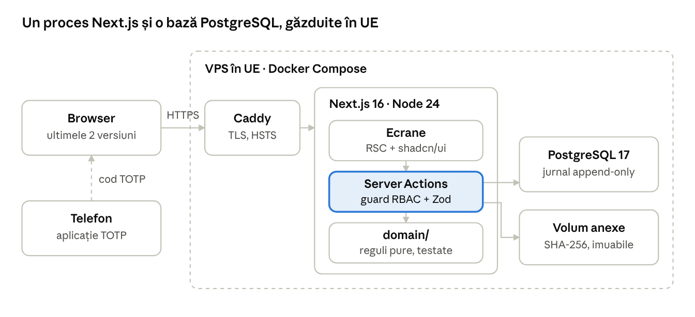
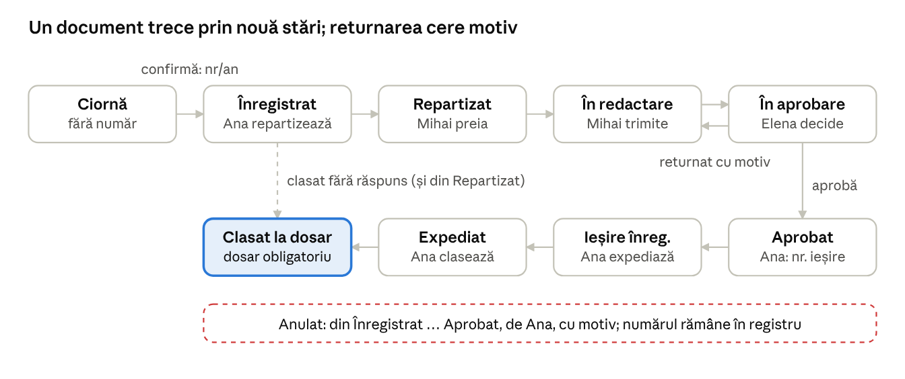

# Registratură și evidența deșeurilor — cerințe tehnice și soluția propusă (Etapa 1)

11.11.2026 · Ionut

> Exportat din documentul live: https://claude.ai/artifact/FLNoavwACtS1QyYBEt6ZE6 (versiunea live are prioritate).

## 1. Scop și context

Propunem o singură aplicație Next.js (TypeScript) cu PostgreSQL, rulată în Docker pe un VPS din UE, care livrează Etapa 1 a BRD v2.2 în 4 săptămâni, cu un singur dezvoltator. Documentul îi permite lui Ionut să înceapă codul fără întrebări de business: schema, regulile, endpoint-urile, ecranele și testele sunt fixate aici.

**Sursa de adevăr:** BRD v2.2 (`01_brd/BRD_v2.2.md`, versiunea live are prioritate). Nicio regulă de business nu se schimbă aici; contradicțiile sunt în secțiunea 16, cu soluția propusă.

**Obiectivul demo-ului:** un instrument de vânzare pentru prima întâlnire cu ADI Eco Buzău 2009 — 15 minute fără greș, prezentate explicit ca prototip. Cele cinci momente „wow”, în ordinea scenariului:

1. Autentificare cu 2FA: codul QR se scanează live cu telefonul (L1–L3).
2. Circuitul complet al unui document: înregistrare → repartizare → returnare motivată → aprobare → număr de ieșire → expediere → căutare după numărul extern (R1–R8).
3. Importul unui CSV „murdar”, cu erorile semnalate pe loc (D2–D4).
4. Click pe totalul unei UAT și coborâre până la tichetul de cântar (D5).
5. Estimarea AFM cu formula vizibilă și un export CSV care se deschide corect în Excel românesc (D7, N04).

**Nivel de detaliu pe etape:**

| Etapă | Tratare în acest document | Cerințe BRD |
| --- | --- | --- |
| 1 — Demo | Detaliu complet: schemă, logică, API, ecrane, teste | S01–S03, S05, S07, S08; R01–R09 (R03 fără închiderea anului); D03, D05, D06, D08; A02–A04, A07–A09; N01–N06, N08, N09; set de date demo |
| 2 — După semnare | Proiectare: tabele și puncte de extensie gata, fără implementare | S04 (utilizare), S06; R03 închiderea anului; D01, D02, D04, D07; A01, A05, A06, A10, A11; N07 |
| 3 — Exploatare | Doar note de proiectare | Găzduire de producție, SIRUTA real, migrare, confirmarea I01–I17, arhivare electronică |

**Convenții:** text în română; identificatorii de cod, tabelele și coloanele în engleză. Fiecare componentă, endpoint, tabel și test citează ID-urile BRD (S/R/D/A/N/V, pașii R1–R8, D1–D7, L1–L6). Ipotezele I01–I17 sunt valori de configurare, nu constante în cod (secțiunea 3).

## 2. Arhitectură

Arhitectura este un monolit modular: un singur proces Next.js (App Router) care servește interfața și logica de server, o bază PostgreSQL și un volum de fișiere pentru anexe. Toată logica de business stă în `src/domain` (TypeScript pur, fără Next.js), ca să poată fi testată unitar și mutată într-un backend separat dacă producția o cere.



Orice mutație trece prin Server Actions, unde se verifică rolul și datele înainte ca regulile din `domain/` să scrie în bază; aceeași compunere Docker rulează și pe laptop, ca rezervă offline.

### Straturi și structura proiectului

```
src/
  app/                 # rute App Router (ecrane, layout, print)
    (auth)/login, (auth)/2fa, (auth)/enrol
    (app)/registry, (app)/waste, (app)/journal, (app)/demo
    api/               # Route Handlers: export CSV, descărcare anexe, import
  server/
    actions/           # Server Actions (mutații), un fișier per modul
    queries/           # citiri pentru Server Components
    auth/              # sesiune, guard-uri RBAC, TOTP
  domain/              # reguli pure: stări, numerotare, termene, V1–V6, calcule AFM
  db/                  # schema Drizzle, migrări SQL, tranzacții, jurnal
  storage/             # adaptor fișiere (volum local; S3 în Etapa 3)
  seed/                # loader set demo + mutarea datelor
  config/              # parametri I01–I17, citiți din DB + .env
tests/ unit/, integration/, e2e/
```

Reguli de stratificare: componentele UI nu importă din `db/`; orice mutație trece prin `server/actions` → `guard(rol, acțiune)` → `domain` → `db.transaction` care scrie și în jurnal (N09). Verificarea accesului se face doar pe server (R07).

### Alegeri de stack

| Subiect | Decizie | Justificare | Alternativă respinsă |
| --- | --- | --- | --- |
| Framework | Next.js 16.x (App Router), React 19, TypeScript strict, versiuni fixate exact (`"next": "16.x.y"`, fără `^`) | Decis în `decisions_and_constraints.md`. Doar API-uri stabile: Server Components, Server Actions, Route Handlers; fără PPR sau opțiuni experimentale | Java + UI separat (decizie luată) |
| Runtime | Node.js 24 LTS, output `standalone` în imagine Docker | Aceeași imagine rulează pe server, local (rezerva offline) și on-prem | Runtime Edge: nu suportă Argon2 nativ și tranzacții Postgres pe TCP |
| Bază de date | PostgreSQL 17 | Tranzacții, constrângeri, `ON CONFLICT`, triggere pentru jurnalul append-only | — |
| ORM | **Drizzle ORM** + `drizzle-kit` pentru migrări SQL versionate | SQL explicit, tranzacții și `SELECT … FOR UPDATE` la vedere, fără motor binar în imagine; tipuri generate din schemă | Prisma: motor separat, tranzacții interactive mai greu de controlat, triggere și indecși parțiali scriși oricum în SQL brut |
| Autentificare | Implementare proprie, mică: `@node-rs/argon2` (Argon2id), `otpauth` (TOTP RFC 6238), sesiuni în DB cu cookie opac | Control complet asupra pașilor parolă → cod, replay, blocare 5 min și jurnal (S01–S08) | Auth.js: Credentials + TOTP în doi pași este incomod, sesiunile JWT nu se pot revoca; Better Auth: implicitele pluginului 2FA diferă de BRD |
| Validare | Zod pe toate intrările (formulare, CSV, parametri de URL) | Aceleași scheme pe client și server; mesaje în română | — |
| UI | shadcn/ui (Radix) + Tailwind CSS 4; TanStack Table pentru tabele | Comportament WCAG de bază (focus, ARIA) pentru dialoguri, meniuri, select | MUI: temă grea, mai greu de adaptat la print |
| Stocare anexe | Volum Docker local, adresare după SHA-256, în spatele interfeței `FileStorage` | Anexa nu se poate modifica (R02); backup simplu cu volumul | S3/Blob în demo: încă un furnizor și încă o regiune de verificat |
| PDF / imprimare | Imprimare din browser cu `@media print` și `@page { size: A4 }` | O pagină A4 fără navigație (N06), zero dependențe | Puppeteer pe server: Chromium în imagine, +400 MB, încă un punct de eșec în demo |
| Joburi programate | Niciunul în Etapa 1: termenele se calculează la citire. Etapa 2: **pg-boss** (coadă în Postgres) pentru alerte și memento 25 ianuarie | Fără infrastructură în plus | Redis + BullMQ: încă un serviciu; cron extern Vercel: leagă de un furnizor |
| CSV | `csv-parse` (sync) la import; serializator propriu la export (BOM, `;`, virgulă zecimală) | Control exact al formatului I10/N04 | PapaParse: orientat pe browser |
| Timp | `timestamptz` în DB; afișare și calcule de an/zi în `Europe/Bucharest` prin `@date-fns/tz` | Anul contorului și termenele depind de ora României (numerotare 2, N05) | Calcule în UTC: greșite în noaptea de Revelion |
| Cantități | Stocate în **kilograme, `integer`**; afișate în tone cu 3 zecimale | Exact: 0,020 t = 20 kg, fără erori de virgulă mobilă la V3 și la totaluri | `numeric` + `number` în JS: rotunjiri la sume |
| Teste | Vitest (unitar, integrare pe Postgres real), Playwright + `@axe-core/playwright` | Vezi secțiunea 11 | Jest: mai lent, ESM incomod |

**Unde ar conta o eventuală revizuire a stack-ului pentru producție:** joburile programate (pg-boss sau un worker separat), audit și tranzacții (deja explicite în `db/`), și SSO. Stratul `domain/` nu depinde de Next.js, deci poate fi portat.

## 3. Medii, găzduire în UE, configurare și secrete

Demo-ul rulează ca `docker compose` cu trei servicii, pe un VPS din Germania (Hetzner Cloud, Falkenstein sau Nuremberg); aceeași compunere rulează pe laptop ca rezervă offline.

**Decizie de găzduire:** VPS UE + Docker Compose (Caddy pentru TLS automat, aplicația, PostgreSQL 17 cu volum persistent). Un singur furnizor, o singură regiune UE, datele și anexele în același loc. **Respins:** Vercel `fra1` + Neon EU — cold start-uri în timpul demonstrației, anexele ar cere un al treilea serviciu, iar varianta on-prem cerută ulterior ar fi alt mod de rulare. Un VPS românesc (ex. M247, Romarg) este echivalent și rămâne opțiune dacă clientul o cere.

| Mediu | Unde | Date | Scop |
| --- | --- | --- | --- |
| `local` | Laptopul dezvoltatorului, `docker compose up` | Set demo, resetabil | Dezvoltare; **rezerva offline** pentru întâlnire |
| `ci` | GitHub Actions, serviciu Postgres | Set demo, recreat la fiecare rulare | Teste, validator, axe |
| `demo` | VPS UE, `https://demo.<domeniu>` | Set demo, resetabil din aplicație | Întâlnirea cu clientul |
| `prod` (Etapa 3) | De stabilit cu beneficiarul (cloud UE sau on-prem) | Date reale, fără resetare | Exploatare |

### Variabile de mediu și secrete

| Variabilă | Exemplu / regulă | Secret |
| --- | --- | --- |
| `DATABASE_URL` | Rolul aplicației `app_rw` (fără drept de UPDATE/DELETE pe jurnal) | Da |
| `DATABASE_ADMIN_URL` | Rol `app_admin`, folosit doar de migrări și de resetarea demo | Da |
| `TOTP_ENC_KEY` | 32 de octeți, base64; criptează secretele TOTP (AES-256-GCM) | Da |
| `SESSION_PEPPER` | 32 de octeți; HMAC peste token-ul de sesiune înainte de stocare | Da |
| `FILE_STORAGE_DIR` | `/data/files` (volum) | Nu |
| `APP_MODE` | `demo` → marcaj „DEMO — date fictive”, parole afișate la login, buton de resetare | Nu |
| `TZ_APP` | `Europe/Bucharest` | Nu |
| `DEMO_RESET_ENABLED` | `true` doar în `local`/`ci`/`demo`; `false` blochează ruta de resetare | Nu |
| `DEMO_WASTE_SHIFT` | `months` (regula setului de date) sau `years` (implicit, decis la Q1; vezi C3) | Nu |

Secretele stau într-un fișier `.env` cu drepturi `600` pe VPS și în GitHub Actions Secrets; nu intră în imagine sau în depozit. Cheia `TOTP_ENC_KEY` se rotează prin re-criptare (coloană `totp_key_version`).

### Ipotezele I01–I17 ca parametri

Fiecare ipoteză este o valoare în tabelul `settings` (cheie → JSON) sau `annual_parameters` (pe an), citită prin `config/getSetting()`. Nicio valoare nu apare ca literal în `domain/`.

| Ipoteză | Cheie de configurare | Valoare demo | Unde se folosește |
| --- | --- | --- | --- |
| I01 | `registry.mode` | `single_annual` | Alocarea numărului (contor pe an; extensibil la contor pe sens) |
| I02 | `registry.reply_numbering` | `new_number` | Înregistrarea ieșirii (alternativa `same_number`) |
| I03 | `deadlines.enabled`, `deadlines.days_by_type` | `true`; petitie 30, informatii\_publice 10, altele 30, redirectionare 5, avertizare 5, prelungire max. 15 | Calculul termenului (R04) |
| I04 | Tabelul `dossiers` | 5 dosare din `nomenclator.json` | Clasarea (R03) |
| I05 | `annual_parameters.annex6_pct` | 45 (2025, 2026) | Q\_ob (D03) |
| I06 | `afm.qmun_basis` | `all_validated_rows` | Baza Q\_mun (D03) |
| I07 | `rbac.matrix` (fișier `config/rbac.ts`, versiune în DB) | Matricea BRD | Guard-uri server + UI |
| I08 | `annual_parameters.tolerance_kg` | 20 | V3 |
| I09 | `waste.shared_route_policy` | `evidence_or_director_rule` | V4, atribuirea rutei comune |
| I10 | `csv.format` | UTF-8 (BOM acceptat), `;`, virgulă zecimală, antet exact | Import/export |
| I11 | `afm.unorganized_kg_per_capita` | urban 233, rural 105 | Q\_est (D03) |
| I12 | `afm.eligible_destinations` | sortare, reciclare, compostare, altă valorificare | Q\_val (D03) |
| I13 | `payt.fee_calculation_enabled` | `false` | Etapa 2 (D02) |
| I14 | `auth.mfa_required`, `auth.mfa_reset_role` | `true`, `director` | Login, reset 2FA (S06) |
| I15 | `a11y.target` | `WCAG21AA` | Doar documentare (A01, A11) |
| I16 | `uats.contracted_qty_kg` + `afm.generation_index` | populație × 0,233 / 0,105 | Date UAT (D02) |
| I17 | `uats.siruta` (sursă `demo`) | 900001–900007 | Toate; producția încarcă nomenclatorul INS |

Parametrii din `parametri.json` se încarcă la resetare. Pentru ajustarea valorilor AFM înainte de întâlnire (cerere din `decisions_and_constraints.md`), se modifică parametrii din `gen_seed.py` (factor de cantitate și pondere eligibilă pe UAT), se regenerează setul, se rulează validatorul și se actualizează oracolul din teste.

## 4. Model de date fizic

Schema are 21 de tabele care acoperă cele 16 entități din modelul conceptual BRD, plus sesiuni, setări și respingerile de import. Cheile sunt `uuid` (generate cu `gen_random_uuid()`), cu excepția jurnalului (`bigserial`, ordine strictă). Toate tabelele au `created_at timestamptz default now()`; tabelele modificabile au `version int` pentru blocare optimistă (două file deschise nu se suprascriu).

### Enumerări

| Enum | Valori (cod) → etichetă UI | BRD |
| --- | --- | --- |
| `user_role` | `registrar` Registrator · `officer` Responsabil ADI · `director` Director | Roluri |
| `doc_direction` | `incoming` Intrare · `outgoing` Ieșire · `internal` Intern | R01 |
| `doc_status` | `draft` Ciornă · `registered` Înregistrat · `assigned` Repartizat · `drafting` În redactare · `in_approval` În aprobare · `approved` Aprobat · `outgoing_registered` Ieșire înregistrată · `dispatched` Expediat · `filed` Clasat la dosar · `cancelled` Anulat | Stări document |
| `request_type` | `petition` · `public_info` · `institution_letter` · `operator_report` · `reply` · `internal` · `other` | R04 |
| `intake_channel` | `email` · `post` · `courier` · `hand_delivery` · `in_person` (depunere la sediu) | R06 |
| `dispatch_channel` | `email` · `post` · `courier` · `hand_delivery` | R09 |
| `waste_fraction` | `residual` reziduale · `paper_cardboard` hârtie-carton · `plastic_metal` plastic-metal · `glass` sticlă · `biowaste` biodeșeuri · `bulky` voluminoase · `other` altele | Dicționar |
| `destination_type` | `sorting` sortare · `mbt` TMB · `composting` compostare · `recycling` reciclare · `other_recovery` altă valorificare · `landfill` depozitare | Dicționar |
| `waste_row_status` | `imported` Importat · `flagged` Semnalat · `corrected` Corectat · `excluded` Exclus · `validated` Validat · `approved` Aprobat | Stări rânduri |
| `waste_rule` | `V1` … `V6` | Reguli V |
| `uat_environment` | `urban` · `rural` | D02 |

Maparea valorilor din CSV și din setul demo (`hârtie-carton`, `in_redactare` etc.) spre aceste coduri stă într-un singur fișier, `domain/codes.ts`, folosit de import, export și loader.

### Schema (PostgreSQL 17)

```sql
-- Identitate și securitate (S01–S08)
CREATE TABLE users (
  id uuid PRIMARY KEY DEFAULT gen_random_uuid(),
  username text UNIQUE NOT NULL,
  display_name text NOT NULL,
  role user_role NOT NULL,
  password_hash text NOT NULL,                 -- Argon2id
  totp_secret_enc bytea,                       -- AES-256-GCM(iv|ct|tag); NULL = neinrolat
  totp_key_version smallint,
  totp_enrolled_at timestamptz,
  totp_last_step bigint,                       -- ultimul pas acceptat: anti-replay (S03)
  failed_mfa_count smallint NOT NULL DEFAULT 0,
  locked_until timestamptz,                    -- S05
  version int NOT NULL DEFAULT 0
);
CREATE TABLE recovery_codes (
  id uuid PRIMARY KEY DEFAULT gen_random_uuid(),
  user_id uuid NOT NULL REFERENCES users ON DELETE CASCADE,
  code_hash text NOT NULL,                     -- Argon2id
  used_at timestamptz                          -- S04
);
CREATE TABLE sessions (
  id text PRIMARY KEY,                         -- HMAC-SHA256(token, SESSION_PEPPER)
  user_id uuid NOT NULL REFERENCES users ON DELETE CASCADE,
  stage text NOT NULL CHECK (stage IN ('password_ok','enrolling','active')),
  pending_totp_secret_enc bytea,               -- doar în timpul înrolării
  last_seen_at timestamptz NOT NULL,
  expires_at timestamptz NOT NULL,             -- last_seen + 30 min (S07)
  ip inet, user_agent text
);

-- Configurare (I01–I17)
CREATE TABLE settings (key text PRIMARY KEY, value jsonb NOT NULL, updated_by uuid, updated_at timestamptz);
CREATE TABLE annual_parameters (
  year smallint PRIMARY KEY,
  annex6_pct numeric(5,2) NOT NULL,            -- I05
  recycling_target_pct numeric(5,2) NOT NULL,  -- D01
  tolerance_kg integer NOT NULL,               -- I08
  afm_rate_lei_per_t integer NOT NULL          -- 50
);

-- Registratură (R01–R09)
CREATE TABLE registry_counters (
  year smallint PRIMARY KEY,
  last_number integer NOT NULL CHECK (last_number >= 0)   -- R06, numerotare 1–7
);
CREATE TABLE dossiers (
  id uuid PRIMARY KEY DEFAULT gen_random_uuid(),
  code text UNIQUE NOT NULL,                   -- indicativ, ex. I-1
  title text NOT NULL,
  retention text NOT NULL                      -- „10 ani”, „Permanent”
);
CREATE TABLE archive_years (
  year smallint PRIMARY KEY,
  closed_at timestamptz, closed_by uuid REFERENCES users,  -- R03 (Etapa 2)
  approved_by uuid REFERENCES users
);
CREATE TABLE documents (
  id uuid PRIMARY KEY DEFAULT gen_random_uuid(),
  year smallint NOT NULL,
  number integer,                              -- NULL cât timp e ciornă
  direction doc_direction NOT NULL,
  status doc_status NOT NULL DEFAULT 'draft',
  registered_at timestamptz,                   -- momentul confirmării
  correspondent_name text NOT NULL,
  correspondent_address text,                  -- R05: fără CNP, fără alte date
  external_ref text,                           -- ex. 438/2026 (numerotare 7)
  subject text NOT NULL,
  request_type request_type NOT NULL,
  intake_channel intake_channel,
  deadline date,                               -- calculat (R04)
  deadline_extension_days smallint NOT NULL DEFAULT 0,
  redirected boolean NOT NULL DEFAULT false,   -- petitie redirecționată, termen 5 zile
  assignee_id uuid REFERENCES users,
  dossier_id uuid REFERENCES dossiers,
  filed_at timestamptz,
  linked_document_id uuid REFERENCES documents, -- intrare ↔ răspuns (simetric)
  reply_draft text,                            -- ciorna de răspuns (Mihai)
  cancel_reason text,
  created_by uuid NOT NULL REFERENCES users,
  version int NOT NULL DEFAULT 0,
  CONSTRAINT number_iff_registered CHECK ((status = 'draft') = (number IS NULL)),
  CONSTRAINT filed_needs_dossier CHECK (status <> 'filed' OR dossier_id IS NOT NULL),
  CONSTRAINT cancel_needs_reason CHECK (status <> 'cancelled' OR cancel_reason IS NOT NULL)
);
CREATE UNIQUE INDEX documents_year_number ON documents (year, number) WHERE number IS NOT NULL;
CREATE INDEX documents_status ON documents (status);
CREATE INDEX documents_assignee ON documents (assignee_id);
CREATE INDEX documents_deadline ON documents (deadline) WHERE status NOT IN ('filed','cancelled','dispatched');
CREATE INDEX documents_search ON documents USING gin (
  to_tsvector('simple', unaccent(coalesce(subject,'') || ' ' || correspondent_name || ' ' || coalesce(external_ref,''))));
CREATE INDEX documents_external_ref ON documents (external_ref);

CREATE TABLE dispatches (
  id uuid PRIMARY KEY DEFAULT gen_random_uuid(),
  document_id uuid NOT NULL REFERENCES documents,  -- documentul de ieșire
  channel dispatch_channel NOT NULL,
  dispatched_on date NOT NULL,
  proof_ref text,                              -- număr de confirmare simulat
  proof_attachment_id uuid,                    -- sau fișier (R09)
  CHECK (proof_ref IS NOT NULL OR proof_attachment_id IS NOT NULL)
);

-- Anexe imuabile (R02, D04)
CREATE TABLE attachments (
  id uuid PRIMARY KEY DEFAULT gen_random_uuid(),
  document_id uuid REFERENCES documents,
  waste_row_id uuid,                           -- FK adăugat după waste_rows
  file_name text NOT NULL,
  mime_type text NOT NULL,
  size_bytes integer NOT NULL CHECK (size_bytes <= 10485760),  -- N02: 10 MB
  sha256 char(64) NOT NULL,
  storage_key text NOT NULL,
  uploaded_by uuid NOT NULL REFERENCES users,
  uploaded_at timestamptz NOT NULL DEFAULT now(),
  CHECK (num_nonnulls(document_id, waste_row_id) = 1)
);
-- trigger: BEFORE UPDATE OR DELETE ON attachments → RAISE EXCEPTION (exceptând rolul app_admin la resetare)

-- Jurnal append-only (R02, N09, S08)
CREATE TABLE audit_events (
  id bigserial PRIMARY KEY,
  occurred_at timestamptz NOT NULL DEFAULT now(),
  actor_id uuid REFERENCES users,              -- NULL pentru evenimente de sistem
  category text NOT NULL CHECK (category IN ('security','registry','waste','config','demo')),
  action text NOT NULL,                        -- ex. document.confirmed, auth.mfa_failed
  entity_type text NOT NULL, entity_id text,
  old_values jsonb, new_values jsonb,
  reason text,
  ip inet
);
CREATE INDEX audit_entity ON audit_events (entity_type, entity_id, occurred_at);
CREATE INDEX audit_security ON audit_events (occurred_at) WHERE category = 'security';
REVOKE UPDATE, DELETE, TRUNCATE ON audit_events FROM app_rw;
-- trigger: BEFORE UPDATE OR DELETE → RAISE EXCEPTION 'audit log is append-only'

-- Evidența deșeurilor (D01–D08)
CREATE TABLE uats (
  id uuid PRIMARY KEY DEFAULT gen_random_uuid(),
  siruta text UNIQUE NOT NULL,
  siruta_source text NOT NULL DEFAULT 'demo',  -- I17: demo | ins
  name text NOT NULL,
  kind text NOT NULL CHECK (kind IN ('municipiu','oraș','comună')),
  environment uat_environment NOT NULL,
  population integer NOT NULL,
  organized_service boolean NOT NULL,          -- I11
  contracted_qty_kg integer NOT NULL,          -- I16
  version int NOT NULL DEFAULT 0
);
CREATE TABLE operators (id uuid PRIMARY KEY DEFAULT gen_random_uuid(), cui text UNIQUE NOT NULL, name text NOT NULL);
CREATE TABLE facilities (id uuid PRIMARY KEY DEFAULT gen_random_uuid(), name text UNIQUE NOT NULL, destination_type destination_type NOT NULL);

CREATE TABLE imports (
  id uuid PRIMARY KEY DEFAULT gen_random_uuid(),
  document_id uuid REFERENCES documents,       -- D05: obligatorie (vezi CHECK)
  file_name text NOT NULL,
  sha256 char(64) NOT NULL,
  uploaded_by uuid NOT NULL REFERENCES users,
  uploaded_at timestamptz NOT NULL DEFAULT now(),
  total_rows integer NOT NULL, rejected_rows integer NOT NULL,
  flagged_rows integer NOT NULL, clean_rows integer NOT NULL,
  is_seed boolean NOT NULL DEFAULT false,
  CHECK (is_seed OR document_id IS NOT NULL)  -- doar importurile din setul demo 2025 nu au intrare
);
CREATE TABLE import_rejections (                 -- V1 și V6: nu devin rânduri
  id uuid PRIMARY KEY DEFAULT gen_random_uuid(),
  import_id uuid NOT NULL REFERENCES imports ON DELETE CASCADE,
  line_no integer NOT NULL,
  rule waste_rule NOT NULL CHECK (rule IN ('V1','V6')),
  ticket_no text,
  reasons text[] NOT NULL,                     -- ex. {"cod_ler: format NN NN NN"}
  raw jsonb NOT NULL
);
CREATE TABLE waste_rows (
  id uuid PRIMARY KEY DEFAULT gen_random_uuid(),
  import_id uuid NOT NULL REFERENCES imports,
  line_no integer NOT NULL,
  period date NOT NULL CHECK (extract(day FROM period) = 1),  -- prima zi a lunii
  year smallint GENERATED ALWAYS AS (extract(year FROM period)::smallint) STORED,
  weighed_at timestamptz NOT NULL,
  ticket_no varchar(30) NOT NULL,
  vehicle_no text NOT NULL,
  operator_cui text NOT NULL,
  uat_id uuid REFERENCES uats,                 -- NULL = neatribuit
  shared_route boolean NOT NULL,
  ler_code char(8) NOT NULL CHECK (ler_code ~ '^\d{2} \d{2} \d{2}$'),
  fraction waste_fraction NOT NULL,
  destination_type destination_type NOT NULL,
  facility_id uuid NOT NULL REFERENCES facilities,
  reported_kg integer NOT NULL CHECK (reported_kg > 0),
  ticket_kg integer,
  supporting_doc text,
  status waste_row_status NOT NULL,
  status_reason text,
  version int NOT NULL DEFAULT 0
);
CREATE INDEX waste_dup_key ON waste_rows (operator_cui, ticket_no, weighed_at);           -- V2
CREATE INDEX waste_summary ON waste_rows (year, uat_id, status, fraction, destination_type); -- D08
CREATE INDEX waste_import ON waste_rows (import_id, line_no);
CREATE TABLE waste_row_route_uats (row_id uuid REFERENCES waste_rows ON DELETE CASCADE, uat_id uuid REFERENCES uats, PRIMARY KEY (row_id, uat_id));
CREATE TABLE waste_flags (
  id uuid PRIMARY KEY DEFAULT gen_random_uuid(),
  row_id uuid NOT NULL REFERENCES waste_rows ON DELETE CASCADE,
  rule waste_rule NOT NULL CHECK (rule IN ('V2','V3','V4','V5')),
  details jsonb NOT NULL,                      -- ex. {"reported_kg":587,"ticket_kg":537}
  duplicate_of uuid REFERENCES waste_rows,     -- V2
  resolved_at timestamptz, resolved_by uuid REFERENCES users, resolution_reason text
);
CREATE INDEX waste_flags_open ON waste_flags (row_id) WHERE resolved_at IS NULL;
ALTER TABLE attachments ADD FOREIGN KEY (waste_row_id) REFERENCES waste_rows;

CREATE TABLE annual_approvals (                  -- D07
  id uuid PRIMARY KEY DEFAULT gen_random_uuid(),
  uat_id uuid NOT NULL REFERENCES uats,
  year smallint NOT NULL,
  approved_total_kg bigint NOT NULL,
  approved_by uuid NOT NULL REFERENCES users, approved_at timestamptz NOT NULL,
  reopened_by uuid REFERENCES users, reopened_at timestamptz, reopen_reason text,
  CHECK ((reopened_at IS NULL) = (reopen_reason IS NULL))
);
CREATE UNIQUE INDEX annual_approval_active ON annual_approvals (uat_id, year) WHERE reopened_at IS NULL;
```

**Rolurile bazei de date:** `app_rw` (aplicația: SELECT/INSERT/UPDATE pe tabelele de business, doar INSERT pe `audit_events`) și `app_admin` (migrări și resetare demo: `TRUNCATE … RESTART IDENTITY`). Triggerul de pe jurnal și anexe permite operația doar dacă `current_user = 'app_admin'`.

**Extensii pentru Etapa 2 deja în schemă:** `archive_years.closed_at` (închiderea anului), `attachments.waste_row_id` (dovezi la rânduri, D04), `annual_approvals` cu redeschidere (D07), `recovery_codes` (S04), `settings.payt.*` (D02). Etapa 2 nu cere migrări de structură, doar cod.

## 5. Logica de domeniu

Toate regulile de mai jos sunt funcții pure în `src/domain` (intrare: starea curentă + actorul + parametrii; ieșire: starea nouă sau o eroare tipată), apelate de Server Actions în interiorul unei tranzacții care scrie și evenimentul de jurnal.

### 5.1 Mașina de stări a documentului

Tranzițiile permise sunt exact cele din tabel; orice altă combinație stare × acțiune × rol întoarce `409 transition_not_allowed` și nu apare în interfață (Roluri: „orice acțiune care nu apare cu Da este interzisă și ascunsă”).



Fluxul principal merge în sensul acelor de ceasornic, de la Ciornă la Clasat; documentele interne trec din Aprobat direct la clasare, fără ieșire și expediere.

| De la | Acțiune (`domain/document.ts`) | La | Cine | Condiții și efecte |
| --- | --- | --- | --- | --- |
| — | `createDraft` | `draft` | Ana | Fără număr; o ciornă ștearsă nu lasă gol (numerotare 3) |
| `draft` | `confirm` | `registered` (intrare, intern) / `outgoing_registered` (ieșire independentă) | Ana | Alocă numărul (5.2), calculează termenul (5.3) |
| `registered`, `assigned` | `assign` / `reassign` | `assigned` | Ana, Elena | Responsabilul trebuie să aibă rolul `officer` |
| `assigned` | `startDrafting` (la prima salvare a ciornei de răspuns) | `drafting` | Mihai, doar dacă `assignee_id = el` | — |
| `drafting` | `submitForApproval` | `in_approval` | Mihai (responsabilul) | `reply_draft` nevid |
| `in_approval` | `return` | `drafting` | Elena | Motiv obligatoriu, vizibil în istoric (R4) |
| `in_approval` | `approve` | `approved` | Elena | — |
| `approved` | `registerOutgoing` | `outgoing_registered` | Ana | Creează documentul de ieșire cu număr nou, legat în ambele sensuri (I02, R5); pentru documente interne: tranziția nu există |
| `outgoing_registered` | `recordDispatch` | `dispatched` | Ana | Canal + dată + dovadă (R09). Starea se oglindește pe intrare și pe ieșire |
| `dispatched`; `approved` (doar intern) | `file` | `filed` | Ana | Dosar obligatoriu; anul arhivistic nu este închis (R03) |
| `registered`, `assigned` | `fileWithoutReply` | `filed` | Ana | Dosar obligatoriu; ex. rapoartele operatorului (D1) |
| `registered` … `approved` | `cancel` | `cancelled` | Ana | Motiv obligatoriu; numărul rămâne în registru, marcat „Anulat” (numerotare 4) |
| orice stare ≠ `draft`, `cancelled` | `correctMetadata` | aceeași | Ana | Motiv obligatoriu; nu se pot modifica `year`, `number`, `direction`; jurnalul păstrează valoarea veche și nouă (R02, R8) |
| `registered` … `in_approval` | `extendDeadline` | aceeași | Elena | Motiv obligatoriu; petitie: totalul prelungirilor ≤ 15 zile (R04) |

**Maparea codurilor din setul demo** (`domain/codes.ts`): `inregistrat`→`registered`, `repartizat`→`assigned`, `in_redactare`→`drafting`, `in_aprobare`→`in_approval`, `aprobat`→`approved`, `iesire_inregistrata`→`outgoing_registered`, `expediat`→`dispatched`, `clasat`→`filed`, `anulat`→`cancelled`, `ciorna`→`draft`. Acțiunile din `istoric` (`confirmat`, `repartizat`, `trimis_la_aprobare`, `returnat`, `aprobat`, `iesire_inregistrata`, `expediat`, `clasat`, `clasat_fara_raspuns`, `anulat`) devin evenimente `audit_events` cu `action` = `document.<acțiune>`.

### 5.2 Numerotarea (R06, numerotare 1–7)

Numărul se alocă în aceeași tranzacție care trece documentul din `draft`, cu o singură instrucțiune atomică:

```sql
INSERT INTO registry_counters (year, last_number) VALUES ($1, 1)
ON CONFLICT (year) DO UPDATE SET last_number = registry_counters.last_number + 1
RETURNING last_number;
```

- `$1` = anul curent în `Europe/Bucharest` la momentul confirmării (resetare la 1 ianuarie, numerotare 2).
- Rândul contorului rămâne blocat până la commit, deci două confirmări simultane se serializează (numerotare 6). Dacă tranzacția eșuează, incrementul se anulează și nu apare gol.
- Indexul unic `documents_year_number` este a doua barieră.
- Ieșirea pentru un răspuns primește un număr nou din același contor (I01, I02); `external_ref` nu participă (numerotare 7).
- După încărcarea setului demo, `registry_counters(2026) = 120`, deci următoarea confirmare dă **121/2026** (R1), apoi 122/2026 (R5) și 123/2026 (D1).

### 5.3 Termene (R04, I03)

- `deadline = data_înregistrării (zi calendaristică, ora României) + zile[tip] + deadline_extension_days`, cu `zile` din `deadlines.days_by_type`: `petition` 30, `public_info` 10, `institution_letter`/`other` 30. `operator_report`, `reply`, `internal`: fără termen (conform setului demo).
- `redirected = true` (petitie greșit îndreptată): termen = înregistrare + 5 zile.
- Zile calendaristice (vezi întrebarea Q5).
- Termenul contează doar cât documentul este în `registered` … `approved`. Indicatori calculați la citire, fără job: **depășit** dacă `azi > deadline`; **aproape** dacă `0 ≤ deadline − azi ≤ 5`. Fiecare are text și pictogramă, nu doar culoare (A04).

### 5.4 Pipeline-ul de import V1–V6 (D05, D06)

Ordinea este cea presupusă de validator și se aplică rând cu rând; un rând respins nu mai trece prin regulile următoare.

1. **Verificări pe fișier** (refuz întreg, nimic nu se scrie): utilizator `officer`; `document_id` este o intrare înregistrată, neanulată (D05); fișier ≤ 10 MB și ≤ 10.000 de rânduri (N02); antetul conține exact cele 15 nume din dicționar (coloanele în plus se ignoră); codificare UTF-8, BOM acceptat.
2. **V1 Format → respins.** Câmpuri obligatorii prezente; `perioada` = `AAAA-LL`; `data_cantaririi` = `AAAA-LL-ZZ HH:MM` și în luna din `perioada`; `nr_tichet` ≤ 30 caractere; `operator_cui` doar cifre; `ruta_comuna` ∈ {Da, Nu}; `uat_ruta` obligatoriu și format din coduri separate prin `|` dacă `ruta_comuna = Da`; `cod_ler` = `NN NN NN`; `fractie` și `destinatie_tip` din listă; `cantitate_raportata_t` > 0 cu cel mult 3 zecimale și virgulă; `cantitate_tichet_t` gol sau același format. Toate motivele unui rând se adună (nu doar primul) în `import_rejections.reasons`.
3. **V6 Perioadă închisă → respins.** Există `annual_approvals` activă pentru (UAT-ul rândului sau oricare UAT din `uat_ruta`, anul din `perioada`).
4. **V2 Duplicat → semnalat.** Cheia (`operator_cui`, `nr_tichet`, `data_cantaririi`) există deja în `waste_rows` (orice stare) sau mai sus în același fișier. Prima apariție rămâne curată; a doua primește `duplicate_of`. Cheile existente se încarcă o singură dată într-un `Set`, pentru perioadele din fișier.
5. **V3 Diferență → semnalat** dacă `ticket_kg` există și `|reported_kg − ticket_kg| > tolerance_kg` (20 kg, I08). Comparație pe întregi, fără virgulă mobilă.
6. **V4 Neatribuit → semnalat** dacă `uat_siruta` este gol sau `ruta_comuna = Da` (la import nu există încă dovadă, I09). `uat_id` rămâne NULL; codurile din `uat_ruta` se salvează în `waste_row_route_uats`.
7. **V5 UAT necunoscut → semnalat** (doar dacă V4 nu s-a aplicat) dacă `uat_siruta` nu este în `uats`. `uat_id` rămâne NULL.
8. Starea rândului: `flagged` dacă are cel puțin o semnalare (V3 și V4 pot coexista), altfel `imported`.

Importul rulează într-o singură tranzacție, sub `pg_advisory_xact_lock(hashtext('waste_import'))`, ca două importuri simultane să nu rateze un duplicat. Inserarea se face în loturi de 500. Rezultatul așteptat pe `import_2026-10_scenariu_erori.csv`: 26 rânduri → 1 respins V1 (T-2026-002539), 1 V2 (T-2026-002535), 1 V3 (T-2026-002543), 1 V4 (T-2026-002534), 22 fără semnalări (D3).

### 5.5 Stările rândurilor de deșeu (D06, D07)

| De la | Acțiune | La | Cine | Condiții |
| --- | --- | --- | --- | --- |
| `imported` | `validate` (individual sau „Validează rândurile curate”) | `validated` | Mihai | — |
| `flagged`, `validated` | `correct` | `corrected` → imediat `imported` sau `flagged` | Mihai | Motiv obligatoriu; se reiau V2–V5 pe rând; semnalările vechi se închid cu motivul corecției |
| `flagged` (V4/V5) | `assignUat` | `corrected` → re-verificare | Mihai | Motiv + referință la dovadă sau la regula aprobată de director (I09) |
| `imported`, `flagged` | `exclude` | `excluded` | Mihai | Motiv obligatoriu (ex. duplicat confirmat) |
| `excluded` | `reactivate` | `imported` / `flagged` | Mihai | Motiv; se reiau verificările |
| `validated` | `approveYear` | `approved` | Elena | Etapa 2 (5.7) |
| `approved` | `reopenYear` | `validated` | Elena | Etapa 2, motiv |

`corrected` este o stare tranzitorie în aceeași tranzacție: jurnalul o înregistrează, dar rândul ajunge imediat în rezultatul re-verificării (BRD: „Verificările se reiau”). Rândurile `approved` nu se pot modifica (D07).

### 5.6 Calcule (D03, D08; D01 și D02 în Etapa 2)

Toate calculele lucrează în kilograme întregi; rotunjirea se face o singură dată, la afișare (tone cu 3 zecimale, lei la întreg, jumătate în sus).

- **Total validat (D08)** = Σ `reported_kg` pentru rândurile `validated` + `approved`, cu `uat_id` nenul. Separat: *nevalidate* (`imported`, `flagged`, `corrected`), *excluse*, *neatribuite* (`uat_id` NULL, neexcluse).
- **Estimare AFM (D03)** pe UAT și an: `Q_mun` = total validat al anului (rânduri `approved` pentru an aprobat; `validated`, marcat „provizoriu”, pentru anul curent — I06). `Q_val` = aceeași sumă restrânsă la `afm.eligible_destinations` (I12). `Q_ob = annex6_pct/100 × Q_mun`. `C = max(0, Q_ob − Q_val) × afm_rate_lei_per_t / 1000`. UAT fără serviciu organizat (I11): `C = Q_est × 50 lei/t`, cu `Q_est = 233 kg × populație` (urban) sau `105 kg × populație` (rural).
- **Oracol 2025** (din `04_seed_data/README.md`, reprodus independent din CSV): Râmnicu Sărat 93.793 · Nehoiu 33.518 · Pogoanele 22.758 · Berca 14.923 · Vadu Pașii 13.868 · Cislău 8.216 · Breaza 3.745 lei.
- **Indicator de reciclare (D01, Etapa 2):** Σ destinațiile sortare + reciclare + compostare / total aprobat, afișat lângă ținta anului din `annual_parameters`.
- **Date PAYT (D02, Etapa 2):** pe UAT și an — total aprobat pe fracții, mediu, populație, cantitate contractată; pe mediu — Σ aprobat vs Σ contractat și diferența; `payt.fee_calculation_enabled = false` (I13).

### 5.7 Aprobarea și redeschiderea anuală (D07 — proiectare, Etapa 2)

- `approveYear(uat, year)`: doar Elena. Refuzată dacă există rânduri `flagged` sau `corrected` pentru (UAT, an); răspunsul listează rândurile (D6). Altfel, într-o tranzacție: rândurile `validated` → `approved`, se inserează `annual_approvals` cu totalul în kg.
- `reopenYear(uat, year, reason)`: doar Elena; rândurile `approved` → `validated`; aprobarea primește `reopened_*`. După redeschidere, V6 nu mai respinge rândurile acelui an.
- În Etapa 1 tabelul există și este populat de setul demo (2025 aprobat pentru toate cele 7 UAT-uri), ca V6 să funcționeze.

## 6. Autentificare și autorizare

Autentificarea are doi pași verificați pe server (parolă, apoi cod TOTP), iar autorizarea se aplică în fiecare Server Action și Route Handler printr-un singur guard, nu în interfață.

### 6.1 Parole (S01)

- Hash Argon2id (`@node-rs/argon2`): memorie 19 MiB, 2 iterații, paralelism 1 (recomandarea OWASP). Parolele demo din `utilizatori.json` se hash-uiesc la încărcare; nu se stochează în clar.
- Pentru un utilizator inexistent se verifică un hash fictiv, ca timpul de răspuns să nu dezvăluie conturile.
- În `APP_MODE=demo`, ecranul de autentificare afișează cele trei conturi și parolele (S01).
- Limitare: 10 încercări de parolă pe minut pe IP (contor în memorie) — măsură de produs, nu cerință BRD.

### 6.2 Fluxul de autentificare cu 2FA (S02, S03, S05)

1. **Parolă corectă** → sesiune nouă cu `stage = 'password_ok'` (sau `'enrolling'` dacă `totp_secret_enc` este NULL), valabilă 10 minute. Jurnal: `auth.password_ok` / `auth.password_failed`.
2. **Înrolare (L1, L2):** se generează un secret de 20 de octeți (160 de biți, `crypto.randomBytes`), păstrat criptat în `sessions.pending_totp_secret_enc` până la confirmare. Ecranul arată codul QR pentru `otpauth://totp/ADI%20Demo:<username>?secret=<BASE32>&issuer=ADI%20Demo&algorithm=SHA1&digits=6&period=30`, generat pe server ca SVG (`qrcode`, fără serviciu extern), și cheia în text, grupată câte 4 caractere, cu buton de copiere (A08). Contul devine activ doar după un cod valid; atunci secretul se mută criptat în `users`, se generează cele 10 coduri de recuperare și sesiunea devine `active`.
3. **Verificarea codului (L3):** `step = floor(unix_time / 30)`. Codul se compară (în timp constant) cu pașii `step−1`, `step`, `step+1`. Se acceptă doar dacă pasul găsit este **mai mare** decât `users.totp_last_step` (anti-replay: un cod folosit nu mai trece, nici unul mai vechi). Citirea și actualizarea rândului `users` se fac sub `SELECT … FOR UPDATE`, ca două cereri simultane cu același cod să nu treacă amândouă.
4. **Succes:** `totp_last_step = pasul găsit`, `failed_mfa_count = 0`, ID-ul sesiunii se schimbă (anti-fixare), `stage = 'active'`. Jurnal `auth.mfa_ok`.
5. **Eșec (L4):** `failed_mfa_count + 1`; la al 5-lea eșec consecutiv `locked_until = now() + 5 min`, contorul revine la 0, jurnal `auth.locked`. Cât timp contul este blocat, atât parola cât și codul sunt refuzate cu mesajul „Cont blocat până la HH:MM”.

Câmpul de cod: `inputmode="numeric"`, `autocomplete="one-time-code"`, acceptă lipire, elimină spațiile; fără CAPTCHA (A08).

### 6.3 Coduri de recuperare (S04)

- Se generează 10 coduri la înrolare (10 caractere din alfabetul Crockford Base32, afișate `XXXXX-XXXXX`), stocate ca hash Argon2id, afișate o singură dată cu „Imprimă” și „Descarcă .txt”. Generarea intră în Etapa 1, pentru că pasul L2 o cere (vezi C1).
- Pe ecranul de cod, linkul „Folosește un cod de recuperare” acceptă un cod; la potrivire se setează `used_at`, iar codul nu mai trece a doua oară (L5, Etapa 2). Un cod greșit crește același contor de eșecuri. Jurnal `auth.recovery_used`.

### 6.4 Resetarea 2FA (S06 — Etapa 2, proiectare)

Acțiunea `resetMfa(userId, reason)` (doar Elena, I14, confirmare A07): `totp_secret_enc = NULL`, șterge codurile de recuperare și toate sesiunile utilizatorului, jurnal `auth.mfa_reset` cu motiv. La următoarea autentificare utilizatorul vede un cod QR nou (L6). Resetarea setului demo readuce oricum toți utilizatorii la „neinrolat”.

### 6.5 Sesiuni (S07, A10)

- Cookie `__Host-adi_session`: token aleator de 32 de octeți, `HttpOnly`, `Secure`, `SameSite=Lax`, `Path=/`. În DB se stochează doar `HMAC-SHA256(token, SESSION_PEPPER)`.
- Expirare la 30 de minute de inactivitate: fiecare cerere autentificată actualizează `last_seen_at`/`expires_at` (cel mult o dată pe minut). Durată maximă absolută: 12 ore.
- Componenta client `SessionTimer` afișează la minutul 28 un dialog `role="alertdialog"` cu focus pe „Prelungește sesiunea” (acțiunea `touchSession`); la expirare redirecționează la `/login?expired=1`.
- Deconectarea șterge rândul din `sessions`. Server Actions au verificarea `Origin` inclusă în Next.js; Route Handlers care modifică date verifică explicit antetul `Origin`.

### 6.6 Jurnal de securitate (S08)

Evenimente cu `category = 'security'` și IP: `auth.password_ok`, `auth.password_failed`, `auth.mfa_enrolled`, `auth.mfa_ok`, `auth.mfa_failed`, `auth.locked`, `auth.recovery_used`, `auth.mfa_reset`, `auth.logout`, `auth.session_expired`. Ecranul „Jurnal” le afișează filtrabil (utilizator, acțiune, interval); în demo îl vede Elena (vezi Q7).

### 6.7 Autorizare (R07, I07)

Matricea BRD devine o hartă de permisiuni în `config/rbac.ts`, verificată de `requirePermission(user, perm, resource?)` la începutul fiecărei mutații și citiri. Interfața folosește aceeași hartă doar ca să ascundă butoanele.

| Permisiune | Ana (`registrar`) | Mihai (`officer`) | Elena (`director`) |
| --- | --- | --- | --- |
| `registry.read` | Toate | Doar `assignee_id = el` | Toate |
| `document.create`, `document.confirm`, `document.correct`, `document.cancel` | Da | — | — |
| `document.assign` | Da | — | Da |
| `reply.draft`, `reply.submit` | — | Doar pe lucrările sale | — |
| `reply.approve`, `reply.return`, `deadline.extend` | — | — | Da |
| `outgoing.register`, `dispatch.record`, `document.file` | Da | — | — |
| `nomenclator.manage` / `year.close.approve` | Da / — | — | — / Da |
| `registry.export`, `document.print` | Da | Doar lucrările sale | Da |
| `waste.import`, `waste.row.correct`, `waste.row.exclude`, `waste.row.assign`, `waste.row.validate` | — | Da | — |
| `waste.year.approve`, `waste.year.reopen` | — | — | Da |
| `uat.edit` / `uat.approve` | — | Da / — | — / Da |
| `waste.summary.read`, `waste.summary.export`, `afm.read` | — | Da | Da |
| `mfa.reset`, `journal.read` | — | — | Da |
| `demo.reset` | Da | Da | Da (doar `APP_MODE=demo`) |

**Filtrul pe rând** pentru registratură este o singură funcție, `scopeDocuments(user)`, care adaugă `WHERE assignee_id = :userId` pentru `officer`. O folosesc lista, căutarea, fișa, exportul CSV, pagina de imprimare și descărcarea anexelor. Un document din afara scopului întoarce **404** (nu 403), ca existența lui să nu fie dezvăluită (R07, R2). Testul R2 deschide direct `/registry/<id>` al unei lucrări nerepartizate și așteaptă 404.

## 7. Interfața serverului

Mutațiile din formulare sunt **Server Actions**; descărcările, exporturile și încărcarea CSV sunt **Route Handlers** (fișiere binare, antete HTTP controlate). Citirile pentru ecrane se fac direct în Server Components prin `server/queries`, cu același guard.

**Contract comun.** Fiecare Server Action primește un obiect validat cu Zod și întoarce `{ ok: true, data }` sau `{ ok: false, code, message, fieldErrors? }`. Mesajele sunt în română și spun cum se corectează (A07). Coduri: `unauthenticated` (redirect la login), `not_found` (și pentru lipsă de acces pe rând), `forbidden`, `validation`, `transition_not_allowed`, `version_conflict`, `account_locked`, `too_large`. Toate mutațiile primesc `version` și scriu jurnalul în aceeași tranzacție (N09).

### Autentificare

| Acțiune | Tip | Intrare | Ieșire / erori | Cine | BRD |
| --- | --- | --- | --- | --- | --- |
| `loginWithPassword` | SA | `username`, `password` | redirect `/2fa` sau `/enrol`; `validation`, `account_locked` | Public | S01, S05, S08 |
| `startEnrolment` | SA (la deschiderea `/enrol`) | — | `qrSvg`, `secretBase32` | Sesiune `enrolling` | S02 |
| `confirmEnrolment` | SA | `code` | `recoveryCodes[10]`; `invalid_code` | Sesiune `enrolling` | S02, S04, L1–L2 |
| `verifyMfa` | SA | `code` sau `recoveryCode` | redirect `/registry` sau ultima pagină; `invalid_code`, `account_locked` | Sesiune `password_ok` | S03, S04, S05, L3–L5 |
| `touchSession` / `logout` | SA | — | `expiresAt` / redirect | Autentificat | S07 |
| `resetMfa` | SA | `userId`, `reason` | — | Elena | S06 (Etapa 2) |

### Registratură

| Acțiune | Tip | Intrare | Ieșire / erori | Cine | BRD |
| --- | --- | --- | --- | --- | --- |
| `saveDraft` | SA | câmpurile fișei (fără CNP), anexe | `documentId` | Ana | R01, R05 |
| `confirmDocument` | SA | `documentId`, `version` | `number`, `deadline` | Ana | R01, R04, R06, R1 |
| `assignDocument` | SA | `documentId`, `assigneeId` | —; `transition_not_allowed` | Ana, Elena | R2 |
| `saveReplyDraft` / `submitForApproval` | SA | `documentId`, `text`, anexe | — | Mihai (responsabil) | R3 |
| `returnReply` / `approveReply` | SA | `documentId`, `reason` (la returnare) | — | Elena | R4 |
| `extendDeadline` | SA | `documentId`, `days`, `reason` | `deadline`; `validation` (peste 15 zile la petitie) | Elena | R04 |
| `registerOutgoing` | SA | `incomingId`, date de ieșire | `outgoingId`, `number` | Ana | R06, R5 |
| `recordDispatch` | SA | `documentId`, `channel`, `date`, `proofRef` sau fișier | — | Ana | R09, R5 |
| `fileDocument` / `fileWithoutReply` | SA | `documentId`, `dossierId` | —; `validation` (fără dosar), `year_closed` | Ana | R03, R6, D1 |
| `correctMetadata` | SA | `documentId`, câmpuri, `reason` | diff vechi/nou | Ana | R02, R8 |
| `cancelDocument` | SA | `documentId`, `reason` | — | Ana | R06 |
| `GET /api/registry/export.csv?<filtre>` | RH | aceleași filtre ca lista | CSV (N04) | Ana, Elena; Mihai în scopul său | R08, R7 |
| `GET /api/attachments/:id` | RH | — | fișierul, `Content-Disposition: attachment`; 404 în afara scopului | după `scopeDocuments` | R02, R07 |
| `POST /api/attachments` | RH (multipart) | fișier ≤ 10 MB, tip permis (PDF, JPG, PNG, DOCX, XLSX, CSV) | `attachmentId`, `sha256`; `too_large` | Ana, Mihai | R02, N02 |
| `upsertDossier`, `closeYear` | SA | indicativ, denumire, termen / `year` | — | Ana / Elena aprobă | R03 (închiderea în Etapa 2) |

### Evidența deșeurilor

| Acțiune | Tip | Intrare | Ieșire / erori | Cine | BRD |
| --- | --- | --- | --- | --- | --- |
| `POST /api/waste/imports` | RH (multipart) | `documentId`, fișier CSV | raport: total, respinse (linie, tichet, motive), semnalate pe regulă, curate; `no_linked_document`, `bad_header`, `too_large` | Mihai | D05, D06, D2–D3 |
| `correctRow` | SA | `rowId`, câmpuri, `reason` | stare nouă + semnalări | Mihai | D06, D4 |
| `assignRowUat` | SA | `rowId`, `uatId`, `reason`, `evidenceRef` | stare nouă | Mihai | D06, I09 |
| `excludeRow` / `reactivateRow` | SA | `rowId`, `reason` | — | Mihai | D06, D4 |
| `validateRows` | SA | `rowIds[]` sau `importId` + `onlyClean` | număr validate | Mihai | D07, D4 |
| `approveYear` / `reopenYear` | SA | `uatId`, `year`, `reason` | total aprobat; `has_open_rows` cu lista | Elena | D07, D6 (Etapa 2) |
| `GET /api/waste/summary.csv?<filtre>` | RH | UAT, perioadă, fracție, destinație | CSV filtrat (N04) | Mihai, Elena | D08, D5 |
| `GET /api/waste/demo-files/:name` | RH | numele unui fișier de import | CSV cu datele mutate (secțiunea 10) | Mihai (doar `APP_MODE=demo`) | Kit demo |

### Demo și administrare

| Acțiune | Tip | Intrare | Ieșire / erori | Cine | BRD |
| --- | --- | --- | --- | --- | --- |
| `resetDemoData` | SA | confirmare text „RESETEAZĂ” | redirect la login (toate sesiunile se închid) | Orice utilizator, doar dacă `DEMO_RESET_ENABLED` | N08, R08 |
| `GET /api/health` | RH | — | `{ db: ok, seedAnchorShiftedTo, version }` | Public | Kit demo |

## 8. Ecrane

Aplicația are 12 ecrane în Etapa 1, toate în același cadru: antet cu banda **„DEMO — date fictive”** (text, nu doar culoare, `role="note"`), navigația filtrată pe rol, utilizatorul curent, „Deconectare”, legătura „Sari la conținut” ca prim element focusabil și `SessionTimer`. Pagina declară `lang="ro"`; datele se afișează `ZZ.LL.AAAA`, cantitățile `1.234,567 t`, sumele `14.923 lei` (`Intl.NumberFormat('ro-RO')`).

| Ecran · rută | Componente și date încărcate | Acțiuni | Stări goale / eroare | Accesibilitate | BRD |
| --- | --- | --- | --- | --- | --- |
| **Autentificare** `/login` | Formular utilizator + parolă; în demo, caseta cu cele 3 conturi și parole | `loginWithPassword` | Parolă greșită: mesaj sub formular; cont blocat: ora de deblocare; `?expired=1`: „Sesiunea a expirat” | Etichete vizibile, eroare legată prin `aria-describedby`, `autocomplete="username"`/`"current-password"` | S01, A07 |
| **Înrolare 2FA** `/enrol` | Pași numerotați: 1) scanează codul QR (SVG, `alt` descriptiv) 2) sau introdu cheia (text + „Copiază”) 3) introdu codul. Apoi ecranul cu 10 coduri de recuperare, „Imprimă”, „Descarcă”, „Am salvat codurile” | `startEnrolment`, `confirmEnrolment` | Cod greșit: „Codul nu este valid. Verificați ora telefonului și introduceți codul curent.” | Copierea anunțată prin `aria-live`; cod lipibil, `one-time-code` | S02, S04, A08, L1–L2 |
| **Cod 2FA** `/2fa` | Câmp de 6 cifre; link „Folosește un cod de recuperare” | `verifyMfa` | Numărul de încercări rămase după un eșec; blocare cu ora | Focus automat pe câmp, mesajele în `aria-live="assertive"` | S03, S05, L3–L4 |
| **Registrul documentelor** `/registry` | Tabel paginat (50/pagină, sortare server): nr/an, dată, sens, corespondent, obiect, stare, responsabil, termen (cu indicator „Depășit” / „Aproape”, text + pictogramă), dosar. Căutare unică (număr intern, număr extern, obiect, corespondent) + filtre: sens, stare, responsabil, termen (depășit / ≤ 5 zile / fără), dosar. Filtrele stau în URL | „Document nou” (Ana), „Export CSV” (lista filtrată) | Niciun rezultat: „Niciun document nu corespunde filtrelor” + „Resetează filtrele”. Mihai fără lucrări: „Nu aveți lucrări repartizate” | `<table>` cu `<caption>`, `<th scope="col">`, `aria-sort`; numărul de rezultate anunțat la filtrare | R01, R04, R07, R08, A06, R2, R7 |
| **Înregistrare document** `/registry/new`, `/registry/:id/edit` | Sens, data înregistrării (implicit azi), corespondent, adresă, număr extern, obiect, tip cerere (afișează termenul calculat înainte de confirmare), canal, dosar (opțional până la clasare), anexe (drag & drop + buton). **Niciun câmp CNP** | „Salvează ciorna”, „Confirmă și atribuie număr” (dialog de confirmare) | Erori pe câmp + sumar de erori cu linkuri în partea de sus | Câmpurile obligatorii marcate cu „(obligatoriu)” în etichetă | R01, R04, R05, R06, A07, R1 |
| **Fișa documentului** `/registry/:id` | Antet: număr, stare (badge cu text), responsabil, termen, dosar + termen de păstrare. Secțiuni: date, anexe (nume, dimensiune, SHA-256 scurt), documente legate, ciorna de răspuns, expediere (canal, dată, dovadă), **istoric** (cronologic: cine, când, acțiune, motiv, valori vechi → noi) | Doar butoanele permise de stare × rol (5.1): Repartizează, Redactează, Trimite la aprobare, Returnează (cu motiv), Aprobă, Înregistrează ieșirea, Consemnează expedierea, Clasează, Corectează (cu motiv), Anulează, Prelungește termenul, Imprimă | Document în afara scopului → pagina 404 „Documentul nu există sau nu aveți acces”; conflict de versiune → „Documentul a fost modificat de altcineva. Reîncărcați.” | Dialoguri Radix cu focus captiv corect și revenire; acțiunile ireversibile cer confirmare (A07) | R02, R03, R06, R09, R3–R8 |
| **Imprimare fișă** `/registry/:id/print` | Aceeași fișă fără navigație, cu marcajul DEMO în antet | `window.print()` | — | Contrast negru pe alb | N06, R08 |
| **Nomenclator și an** `/registry/dossiers` | Tabel dosare (indicativ, denumire, termen de păstrare, nr. documente); anii arhivistici | Adăugare/editare dosar (Ana); închiderea anului (Etapa 2) | — | Tabel cu antet | R03 |
| **Import și verificare** `/waste/imports` + `/waste/imports/:id` | Pas 1: alege intrarea din registratură (listă cu intrările `operator_report`). Pas 2: fișier CSV. Pas 3: raportul (carduri: total, respinse, semnalate pe regulă, curate) + tabelul de rânduri (linie, tichet, UAT, fracție, destinație, raportat t, tichet t, stare, semnalări) cu filtru pe stare/regulă; rândurile respinse într-o listă separată cu motive | Corectează, Exclude, Atribuie UAT, Validează (selecție), „Validează rândurile curate” | Fără intrare legată: butonul de încărcare dezactivat cu explicație; antet greșit: lista coloanelor lipsă | Rezultatul importului anunțat în `aria-live`; semnalările au etichetă text („Duplicat”, „Diferență 0,050 t”, „Neatribuit”, „UAT necunoscut”) | D05, D06, A03, A04, D2–D4 |
| **Situație pe UAT** `/waste/summary` | Filtre: UAT, perioadă (an / lună de la–până la), fracție, destinație. Tabel UAT × total validat (t) cu link; sub el, separat: nevalidate, excluse, neatribuite. **Drill-down**: total → lunile → rândurile → detaliul tichetului (toate câmpurile + dovezi) | Export CSV filtrat; Aprobă anul / Redeschide (Etapa 2) | Nicio dată pentru filtre: mesaj + reset | Firimituri de navigare în drill-down; fiecare nivel are titlu de tabel | D08, D07, A06, D5–D6 |
| **Date UAT și calcule** `/waste/uats` | Tabel UAT (SIRUTA demo, denumire, mediu, populație, serviciu organizat, cantitate contractată). Card AFM pe UAT și an: formula (KaTeX), valorile intrării (p, Q\_mun, Q\_val, Q\_ob) și rezultatul, „provizoriu” pentru anul curent, mesajul cu termenul de 25 ianuarie, marcaj DEMO | Selectare an și UAT; export | — | Formula are și text alternativ (`aria-label` cu formula în cuvinte) | D03, D02 (Etapa 2), D7 |
| **Jurnal** `/journal` | Tabel evenimente: dată-oră, utilizator, categorie, acțiune, obiect, motiv, IP; filtre | Doar citire (N09) | — | Tabel cu antet | S08, N09 |
| **Kit demo** `/demo` | Data-ancoră curentă, cele 3 fișiere de import (cu date mutate), scriptul de 15 minute | „Resetează datele demo” (dialog cu confirmare text) | — | Confirmarea cerută explicit (A07) | N08 |

**Componente partajate:** `DataTable` (TanStack + antet accesibil + export), `StatusBadge` (text + pictogramă + culoare), `DeadlineIndicator`, `ReasonDialog` (motiv obligatoriu, folosit de returnare, anulare, corectare, excludere, prelungire), `ConfirmDialog`, `FileDrop` (cu buton alternativ pentru tastatură), `AuditTimeline`, `DemoBanner`, `FormulaCard`.

## 9. Import și export

Importul și exportul folosesc același format (I10, N04): UTF-8, separator `;`, zecimale cu virgulă, antet cu numele exacte din dicționar. Exportul scrie BOM, ca Excel cu setări românești să afișeze diacriticele corect.

### Import CSV (D05, N02, N03)

- **Limite:** fișier ≤ 10 MB, ≤ 10.000 de rânduri; limita de corp pentru Route Handler setată la 11 MB. Capacitate totală testată: setul demo (5.321 de curse) + 10.000 de rânduri importate.
- **Parsare:** `csv-parse/sync` cu `delimiter: ';'`, `bom: true`, `columns: true`, `relax_column_count: false`, `trim: true`. Fișierul se citește din memorie (≤ 10 MB), nu se scrie pe disc înainte de validare. Amprenta SHA-256 se salvează în `imports`; același fișier încărcat de două ori produce semnalări V2 pe toate rândurile, nu o eroare ascunsă.
- **Numere:** `^\d+(,\d{1,3})?$` → kilograme întregi (`"7,240"` → 7240). Punctul ca separator de mii nu este acceptat (V1 cu motiv explicit).
- **Date:** `data_cantaririi` se interpretează în `Europe/Bucharest` și se stochează `timestamptz`; cheia V2 folosește valoarea textuală normalizată `AAAA-LL-ZZ HH:MM`.
- **Performanță (N03, 2.000 rânduri < 5 s):** o singură citire a cheilor existente pentru perioadele din fișier, validare în memorie, inserare în loturi de 500 într-o tranzacție. Estimare: \~1 s pentru 2.000 de rânduri; testul de performanță din CI o verifică.
- **Raportul de import** se păstrează (`imports` + `import_rejections` + `waste_flags`) și se poate redeschide oricând din fișa intrării legate.

### Export CSV (R08, D08, N04)

- Serializator propriu `toRomanianCsv(rows, columns)`: prefix ``, separator `;`, terminație `\r\n`, ghilimele duble pentru valori cu `;`, `"` sau salt de rând; zecimale cu virgulă și fără separator de mii (`7,240`), date `ZZ.LL.AAAA`.
- **Protecție la injecție de formule:** valorile text care încep cu `=`, `+`, `-`, `@` primesc prefixul `'`.
- Exportul registrului folosește **exact aceeași interogare** ca lista (filtre + `scopeDocuments`), fără paginare, ca să conțină exact rândurile filtrate (R08). Coloane: Număr, Data înregistrării, Sens, Corespondent, Număr extern, Obiect, Tip cerere, Stare, Responsabil, Termen, Dosar.
- Exportul centralizatorului: UAT, SIRUTA, perioadă, fracție, destinație, total validat (t), apoi secțiunile separate nevalidate / excluse / neatribuite și o primă linie „DEMO — date fictive”.
- Numele fișierului: `registru_2026-11-10.csv`, `situatie_uat_2026-11-10.csv`. `Content-Type: text/csv; charset=utf-8`.
- Test de acceptare: fișierul exportat se compară octet cu octet cu un fișier de referință și se deschide manual în Excel (Windows, regional România) înainte de întâlnire.

### Imprimare A4 (N06)

- Ruta `/registry/:id/print` cu foaia de stil `print.css`: `@page { size: A4; margin: 15mm }`, fără navigație, butoane sau banda de sesiune; istoricul se trunchiază la ultimele 15 evenimente cu nota „Istoric complet în aplicație”, ca fișa tipică să încapă pe o pagină.
- Antet: „ADI Eco Buzău 2009 — Registratură”, numărul și „DEMO — date fictive”; subsol: data imprimării și utilizatorul.
- Același mecanism imprimă codurile de recuperare (S04).

## 10. Set de date demo și resetare

Resetarea înlocuiește tot conținutul bazei cu setul din `04_seed_data/` (copiat în imagine la `/app/seed`), cu toate datele mutate astfel încât ancora 10.11.2026 devine ziua dinaintea resetării. Durează sub 10 secunde și se poate rula din aplicație sau din linia de comandă (`pnpm seed:reset`).

### Algoritmul de mutare a datelor

```ts
const anchor = parseISO(params.ancora_date);              // 2026-11-10
const target = subDays(todayIn('Europe/Bucharest'), 1);   // ziua dinaintea resetării
const dayShift = differenceInCalendarDays(target, anchor);
const monthShift = DEMO_WASTE_SHIFT === 'months'
  ? (target.getFullYear() - 2026) * 12 + (target.getMonth() - 10)
  : (target.getFullYear() - anchor.getFullYear()) * 12;   // mod 'years'
if (target.getFullYear() !== anchor.getFullYear()) throw new SeedError('anchor_year_crossed');
```

- **Documente:** `data_inregistrare`, `termen` și fiecare dată din `istoric` + `dayShift` zile. Termenele rămân la același număr de zile de la înregistrare, deci cele două lucrări depășite intenționat (90/2026, 98/2026) rămân depășite, iar celelalte lucrări deschise nu devin depășite. Ora: 09:00 + `nr` minute, ca ordinea numerelor să urmeze ordinea înregistrării.
- **Rânduri de deșeu:** `perioada` și `data_cantaririi` + `monthShift` luni (aceeași zi a lunii, limitată la ultima zi), ca fiecare cântărire să rămână în perioada ei (regula V1).
- **Trecerea într-un an nou** (reset după 31.12.2026) este refuzată cu mesajul „Regenerați setul cu o ancoră nouă (`gen_seed.py`)”, pentru că ar rupe numerele `x/2026` și anul 2025 aprobat (vezi C3).
- Pentru o întâlnire în noiembrie 2026, `monthShift = 0` în ambele moduri: perioadele de deșeuri rămân neschimbate, iar fișierele de import pe octombrie 2026 sunt valabile.

### Pașii loader-ului (`src/seed/load.ts`)

1. Verifică `DEMO_RESET_ENABLED`, ia `pg_advisory_lock`, deschide conexiunea `app_admin`.
2. `TRUNCATE` pe toate tabelele de business, inclusiv `sessions` și `audit_events`, cu `RESTART IDENTITY CASCADE`. Șterge directorul de anexe.
3. `settings` și `annual_parameters` din `parametri.json` (0,02 t → 20 kg; I01–I17 la valorile demo).
4. Utilizatorii din `utilizatori.json`: parolă Argon2id, rol mapat (`registrator`→`registrar`, `responsabil`→`officer`, `director`→`director`), **2FA neinrolat**.
5. Dosarele (`nomenclator.json`), UAT-urile (`uat.json`, `siruta_source = 'demo'`, cantitatea contractată în kg), operatorul `99999901` („Operator de colectare (fictiv)”) și instalațiile (valorile distincte din `instalatie_destinatie`).
6. Documentele din `documente_2026.json`: coduri mapate (5.1), `assignee_id` din `responsabil`, `linked_document_id` într-o a doua trecere (din `legat_de`), înregistrările `expediat` din istoric devin rânduri `dispatches` (canal și dovadă parsate din `detalii`). Pentru fiecare anexă se generează un PDF de o pagină „Document fictiv — DEMO”, cu SHA-256 real.
7. Istoricul fiecărui document devine `audit_events` (`category = 'registry'`). Apoi `registry_counters(2026) = 120`.
8. Rândurile din `seed_deseuri_2025_2026-09.csv` (5.321) cu `COPY`: `aprobat`→`approved`, `validat`→`validated`. Un import `is_seed` pe lună; lunile ianuarie–septembrie 2026 se leagă de intrările `operator_report` corespunzătoare (dosarul II-1).
9. `annual_approvals` pentru 2025 × 7 UAT-uri, cu totalul calculat din rânduri, aprobate de Elena.
10. Scrie în `/data/demo-files` cele trei fișiere de import pe octombrie, mutate cu același `monthShift` (descărcabile din Kit demo).
11. **Auto-verificare** înainte de commit: 120 documente, 19 deschise, 2 depășite, 2 anulate, contor 120, 5.321 rânduri, 7 aprobări 2025, estimarea AFM Berca 2025 = 14.923 lei. Orice abatere anulează resetarea și păstrează datele vechi.
12. Jurnal `demo.reset` (primul eveniment nou), închiderea tuturor sesiunilor, redirect la `/login`.

### Fluxul de resetare (N08)

Butonul „Resetează datele demo” din Kit demo deschide un dialog care explică efectele („Toate modificările și înrolările 2FA se pierd”) și cere tastarea cuvântului RESETEAZĂ. Butonul nu există dacă `DEMO_RESET_ENABLED=false`. Înainte de întâlnire: resetare cu o zi înainte, apoi înrolarea live se face în fața clientului (L1).

## 11. Testare

Criteriul de „gata” al Etapei 1 este verificat automat: CI-ul rulează validatorul setului, testele unitare și de integrare, scenariile Playwright R1–R8, D1–D5, D7, L1–L4 pe setul demo și auditul axe, la fiecare push. Un eșec blochează deploy-ul pe serverul demo.

### Niveluri

| Nivel | Unealtă | Ce acoperă | Rulare |
| --- | --- | --- | --- |
| Unitar | Vitest | Toate funcțiile din `src/domain` | < 10 s, la fiecare push |
| Integrare | Vitest + PostgreSQL real (serviciu CI / `docker compose`) | Tranzacții, numerotare concurentă, triggere jurnal, import complet, scope RBAC | < 2 min |
| End-to-end | Playwright (Chromium, Firefox; Edge = Chromium, verificat manual) | Scenariile de acceptare, din tastatură | < 10 min |
| Accesibilitate | `@axe-core/playwright` pe fiecare ecran, reguli WCAG 2.1 A/AA | Zero erori `critical` / `serious` (A01) | În suita e2e |
| Set de date | `python3 04_seed_data/validate_seed.py 04_seed_data` | Regulile V1–V6, numerotarea, legăturile, absența CNP | Pas CI separat |
| Performanță | Vitest bench pe DB real | 2.000 rânduri importate < 5 s; registru 1.000 documente filtrat < 1 s (N03) | La fiecare push pe `main` |

### Teste unitare pe reguli (selecție obligatorie)

| Regulă | Cazuri |
| --- | --- |
| Mașina de stări (5.1) | Fiecare tranziție permisă × rol trece; un tabel generat cu **toate** combinațiile stare × acțiune × rol verifică că restul sunt refuzate |
| Numerotare (R06) | 20 de confirmări paralele pe DB real → numerele 121–140, fără dubluri sau goluri; rollback nu consumă număr; ciornă ștearsă nu lasă gol; anulare păstrează numărul; 31.12 23:59 vs 01.01 00:01 (ora României) → anul corect, contorul pornește de la 1 |
| Termene (R04) | Petitie = +30; informații publice = +10; redirecționat = +5; prelungire petitie 15 OK, 16 refuzat; indicator „aproape” la 5 zile, nu la 6 |
| V1 | Fiecare motiv separat: câmp lipsă, LER `200301`, fracție din afara listei, cantitate 0, 4 zecimale, punct zecimal, dată în afara perioadei, rută comună fără `uat_ruta` |
| V2–V6 | Duplicat în fișier și față de DB; V3 la 20 kg nu, la 21 kg da; V3 + V4 pe același rând; V5 doar când V4 nu se aplică; V6 înaintea lui V2 |
| Calcule (D03) | Exemplul BRD (120 t, 45 t, p = 45 % → 450 lei); oracolul 2025 pentru toate cele 7 UAT-uri; UAT fără serviciu (I11); rezultat negativ → 0 |
| TOTP (S03) | Vectorii RFC 6238 (SHA-1); ±1 pas acceptat, ±2 refuzat; replay refuzat; cod cu pas mai vechi decât ultimul folosit refuzat; ceas controlat cu `vi.setSystemTime` |
| Blocare (S05) | 4 eșecuri + succes resetează contorul; 5 eșecuri → blocat 5 min; la 5 min + 1 s deblocat |
| CSV (N04) | BOM, `;`, virgulă zecimală, ghilimele, diacritice ș/ț cu virgulă, injecție de formule neutralizată |
| Mutarea datelor | Ancoră → ziua dinaintea resetării; 2 depășite exact; reset după 31.12 refuzat; cântăriri rămân în perioadă în ambele moduri |

### Scenarii end-to-end (Playwright)

Fiecare fișier de test pornește de la un set demo proaspăt resetat (`globalSetup` + reset între fișiere). TOTP se calculează în test din secretul afișat ca text (același pe care l-ar scana telefonul). Pașii folosesc doar tastatura (`page.keyboard`) pentru R, D, L (A02).

| Fișier | Pași | Verificări cheie | Etapă |
| --- | --- | --- | --- |
| `auth.spec.ts` | L1–L4 | QR + cheie text; cont inactiv fără cod; 10 coduri afișate; a doua logare fără QR; 5 coduri greșite → blocat, jurnalul arată încercările | 1 |
| `auth-recovery.spec.ts` | L5–L6 | Cod de recuperare refuzat a doua oară; reset 2FA cu motiv → QR nou | 2 |
| `registry.spec.ts` | R1–R8 | 121/2026, termen = +30; lucrarea nerepartizată → 404 pentru Mihai; returnare cu motiv în istoric; 122/2026 legat; clasare în „Corespondență cu UAT-urile”; căutarea 438/2026 găsește intrarea și răspunsul; corecție cu valoare veche/nouă | 1 |
| `registry-export.spec.ts` | R8 (R08) | CSV-ul exportat conține exact rândurile filtrate; BOM prezent | 1 |
| `waste.spec.ts` | D1–D5, D7 | 123/2026 clasat fără răspuns; raport 1/1/1/1/22; excludere + corecție + validare; drill-down până la tichet; ruta comună separată; AFM Berca 2025 = 14.923 lei cu formula și „DEMO — date fictive” | 1 |
| `waste-v5v6.spec.ts` | — | `import_2026-10_test_V5_V6.csv`: V5 la T-2026-002552, V6 la T-2025-999001, 2 curate | 1 |
| `waste-approval.spec.ts` | D6 | Aprobare refuzată cu rând semnalat, rândul afișat; după aprobare rândurile blocate | 2 |
| `session.spec.ts` | S07 | Ceas simulat: avertizare la 28 min, prelungire; expirare la 30 min | 1 |
| `a11y.spec.ts` | Toate ecranele | axe fără erori critice/grave; „Sari la conținut”; `lang="ro"` | 1 (raport), 2 (blocant complet) |

Verificări manuale înainte de întâlnire: NVDA + Firefox pe Windows pentru R, D, L (A03); exportul deschis în Excel românesc (N04); imprimarea fișei pe A4 (N06); scanarea QR cu Google Authenticator și Microsoft Authenticator.

## 12. Cerințe nefuncționale și accesibilitate

Fiecare cerință N și A are o soluție tehnică numită și o verificare; cele din Etapa 2 au deja suportul de bază în Etapa 1 (componente Radix, tabele semantice).

| ID | Cum se îndeplinește | Verificare | Etapă |
| --- | --- | --- | --- |
| N01 Browsere | Fără API-uri non-standard; `browserslist`: ultimele 2 versiuni Chrome, Edge, Firefox | Playwright Chromium + Firefox; Edge manual | 1 |
| N02 Stocare | PostgreSQL pe volum; anexe pe volum, ≤ 10 MB (CHECK + limită de corp) | Test integrare: 10 MB + 1 octet refuzat; set demo + 10.000 rânduri | 1 |
| N03 Performanță | Import în loturi, chei V2 încărcate o dată; registrul filtrat în SQL cu indecși, paginare server | Bench: 2.000 rânduri < 5 s; 1.000 documente < 1 s | 1 |
| N04 Export | `toRomanianCsv` (secțiunea 9) | Unitar + Excel manual | 1 |
| N05 Limbă și format | Texte în `src/i18n/ro.ts` (o singură limbă, dar centralizat); `Intl` cu `ro-RO`, `Europe/Bucharest`; lint care interzice ş/ţ cu sedilă | Lint + e2e | 1 |
| N06 Imprimare | `print.css`, A4 | Manual + screenshot PDF în Playwright | 1 |
| N07 Accesibilitate | A01–A11 | Vezi mai jos | 1 parțial, 2 complet |
| N08 Persistență și resetare | Date în DB; resetare cu confirmare (secțiunea 10) | e2e: reîncărcare păstrează datele; reset restaurează | 1 |
| N09 Jurnal | `audit_events` append-only (REVOKE + trigger); scris în aceeași tranzacție cu modificarea | Integrare: UPDATE/DELETE pe jurnal eșuează; fiecare Server Action produce un eveniment | 1 |
| A01 WCAG 2.1 AA | Toate cele de mai jos | axe fără critice/grave + verificare manuală | 2 (raportat din 1) |
| A02 Tastatură | Elemente native (`button`, `a`, `input`); Radix gestionează focusul în dialoguri; „Sari la conținut”; `:focus-visible` cu contur de 2 px | e2e doar din tastatură | 1 |
| A03 Cititor de ecran | `header`/`nav`/`main`; etichete pe toate câmpurile; erori prin `aria-describedby`; zonă `aria-live` globală pentru notificări și raportul de import | NVDA + Firefox | 1 |
| A04 Contrast și culoare | Tokeni de culoare verificați 4,5:1 (text) și 3:1 (componente); `StatusBadge` și `DeadlineIndicator` au text + pictogramă | axe + verificare a paletei | 1 |
| A05 Zoom și 320 px | Layout flexibil; tabelele derulabile orizontal în container propriu (excepția permisă) | Playwright la 320 px și zoom 200 % | 2 |
| A06 Tabele | `caption`, `th scope`, `aria-sort`; schimbarea filtrelor anunțată | axe + NVDA | 2 (implementat deja în `DataTable`) |
| A07 Formulare și erori | Etichete vizibile, „(obligatoriu)”, sumar de erori, mesaje care spun cum se corectează; `ConfirmDialog` la anulare, aprobare, reset 2FA, reset date | e2e | 1 |
| A08 Autentificare accesibilă | Lipire permisă, `one-time-code`, cheie text + copiere, fără CAPTCHA | e2e | 1 |
| A09 Limbă | `<html lang="ro">`; font cu ș/ț cu virgulă (Inter / Source Sans 3, subset `latin-ext`) | axe + lint | 1 |
| A10 Timp | Avertizare la 28 min cu prelungire (S07); nicio altă limită de timp | e2e cu ceas simulat | 1 (prin S07) |
| A11 Declarație | Pagină statică `/accesibilitate` cu nivelul și limitările cunoscute | Pagina există | 2 |

## 13. Securitate și GDPR

Demo-ul conține doar date fictive, dar este construit cu măsurile care trec neschimbate în exploatare (R05, GDPR art. 25 și 32); ce lipsește este infrastructura de producție, listată la final.

### Măsuri incluse în Etapa 1

| Risc | Măsură | BRD |
| --- | --- | --- |
| Acces neautorizat | Parolă Argon2id + TOTP obligatoriu; blocare 5 min; sesiuni în DB, revocabile | S01–S07 |
| Acces orizontal (IDOR) | `scopeDocuments` pe toate căile de citire, inclusiv anexe și export; 404 în afara scopului; ID-uri UUID | R07 |
| Furt de sesiune | Cookie `__Host-`, `HttpOnly`, `Secure`, `SameSite=Lax`; token stocat ca HMAC; rotație după 2FA | S07 |
| CSRF | Verificarea `Origin` a Server Actions + verificare explicită în Route Handlers | — |
| XSS | React escapează implicit; fără `dangerouslySetInnerHTML`; CSP: `default-src 'self'`, script-uri cu nonce, `frame-ancestors 'none'` | — |
| Fișiere periculoase | Listă albă de tipuri verificată după conținut (magic bytes), ≤ 10 MB, servite cu `Content-Disposition: attachment` și `X-Content-Type-Options: nosniff`; nume stocat separat de cheia de stocare | R02, N02 |
| Injecție SQL | Doar interogări parametrizate (Drizzle); `raw SQL` doar în migrări | — |
| Injecție de formule CSV | Prefix `'` pentru `= + - @` | N04 |
| Secrete în clar | Secret TOTP criptat AES-256-GCM cu cheie din mediu; coduri de recuperare hash-uite | S02, S04 |
| Modificarea istoricului | Jurnal append-only la nivel de bază de date; anexe imuabile | R02, N09 |
| Transport | TLS 1.2+ prin Caddy (Let's Encrypt), HSTS | — |
| Dependențe | Versiuni fixate, `pnpm audit` și Dependabot în CI | — |

### GDPR (R05)

- **Minimizare:** fișa cere doar numele și adresa corespondentului; nu există câmp CNP, telefon sau e-mail personal. Validatorul și un test e2e verifică absența CNP-ului.
- **Protecție din proiectare:** acces pe rol și pe rând, jurnal de acces la fișe (eveniment `document.viewed` în exploatare; în demo dezactivat, ca să nu umple jurnalul), datele găzduite exclusiv în UE.
- **Date demo:** toate persoanele sunt fictive și marcate „(fictiv)”; banda „DEMO — date fictive” pe fiecare ecran.
- **Pentru exploatare (Etapa 3):** termene de ștergere per dosar (legate de termenul de păstrare), registrul activităților de prelucrare, acord de prelucrare cu furnizorul de găzduire, informarea persoanelor vizate, criptare în repaus a volumelor.

### Limitele serverului demo (de spus explicit clientului)

Fără copii de siguranță automate, monitorizare, plan de continuitate sau test de penetrare (BRD, în afara domeniului). Toate devin cerințe în Etapa 3, împreună cu jurnalul de acces cu IP pentru toate citirile și alertarea administratorului la blocarea unui cont (S05 în exploatare).

## 14. Plan de livrare Etapa 1 și kitul pentru întâlnire

Planul are 4 săptămâni pentru un singur dezvoltator, cu riscurile cele mai mari în prima săptămână: 2FA real, numerotarea atomică, mutarea datelor și un deploy UE funcțional. Săptămâna 4 este șlefuire și repetiție; dacă săptămânile 1–3 alunecă, ea absoarbe întârzierea (ținta de 3–4 săptămâni).

| Săptămână | Obiectiv | Livrabile | Criteriu de ieșire |
| --- | --- | --- | --- |
| 1 — Fundație și riscuri | Tot ce poate strica demo-ul, rezolvat primul | Proiect Next.js fixat, Docker Compose, CI; schema + migrări + roluri DB; loader set demo cu mutarea datelor și auto-verificare; parolă + înrolare QR + verificare TOTP + blocare + sesiune 30 min + jurnal de securitate; contorul de registru cu testul de concurență; deploy pe VPS UE cu TLS | L1–L4 trec pe server; validatorul trece în CI; 20 confirmări paralele → numere unice; QR scanat cu 2 aplicații de telefon |
| 2 — Registratură | Momentul „wow” 2 | Registru (listă, căutare, filtre, export CSV), formular de înregistrare, fișa cu toate acțiunile 5.1, termene și indicatori, anexe imuabile, istoric, imprimare A4, `scopeDocuments` | R1–R8 trec în Playwright, din tastatură; 404 pentru Mihai pe link direct |
| 3 — Deșeuri | Momentele „wow” 3, 4, 5 | Import cu V1–V6 și raport, acțiuni pe rânduri, situație pe UAT cu drill-down până la tichet, export, estimare AFM cu formula, date UAT | D1–D5 și D7 trec; Berca 2025 = 14.923 lei; import 2.000 rânduri < 5 s |
| 4 — Șlefuire și repetiție | 15 minute fără greș | Accesibilitate (axe, NVDA, contrast), stări goale și mesaje, Kit demo, rezerva offline, înregistrarea video, 3 repetiții cronometrate | Criteriul BRD de „gata”: R, D, L cap-coadă din tastatură, fără erori; validator verde |

### Scriptul de 15 minute

| Minut | Cine | Ce se arată | Pași |
| --- | --- | --- | --- |
| 0–2 | — | Contextul: art. 5 lit. g¹ din proiectul de statut; prototip pe date fictive, UAT-uri reale | — |
| 2–4 | Ana | Login, QR scanat live pe telefon, coduri de recuperare | L1–L3 |
| 4–8 | Ana → Mihai → Elena → Ana | 121/2026 → repartizare → returnare cu motiv → aprobare → 122/2026 → expediere → căutare 438/2026 | R1–R7 |
| 8–11 | Ana → Mihai | Raportul pe octombrie ca 123/2026; import „murdar”; erorile semnalate pe loc; excludere, corecție, validare | D1–D4 |
| 11–13 | Elena | Total pe UAT → tichet; export CSV deschis în Excel | D5 |
| 13–15 | Elena | Estimarea AFM Berca 2025 cu formula; pașii următori (Etapele 2–3) | D7 |

### Kitul pentru întâlnire

- **Resetare:** cu o zi înainte, „Resetează datele demo”; apoi înrolarea lui Mihai și Elena pe telefonul de demo (Ana rămâne neînrolată pentru momentul live). Verificare `GET /api/health`.
- **Fișierele de import** descărcate din Kit demo în `Descărcări`, cu nume scurte.
- **Telefon:** Google Authenticator instalat, intrările vechi „ADI Demo” șterse, ora sincronizată automat.
- **Rezerva offline 1:** aceeași imagine Docker pe laptop (`docker compose -f compose.local.yml up`), cu setul demo resetat; fără internet funcționează tot (QR-ul este generat local, fonturile sunt incluse în imagine).
- **Rezerva offline 2:** înregistrare video de 15 minute a scriptului, 1080p, pe laptop și pe stick USB.
- **Rețea:** hotspot de pe telefon ca alternativă la Wi-Fi-ul clientului.
- **Lista de verificare T-1 zi:** reset → health → repetiție completă pe serverul demo → reset din nou → înrolare Mihai/Elena → nu se mai atinge nimic.

## 15. Matrice de trasabilitate

Fiecare cerință din Etapa 1 are cel puțin o componentă și un test automat; cerințele din Etapa 2 au componenta proiectată și testul planificat.

| BRD | Componentă (secțiune) | Tabele | Test | Etapă |
| --- | --- | --- | --- | --- |
| S01 | `loginWithPassword`, Argon2id (6.1) | `users` | `auth.spec` L1; unitar hash | 1 |
| S02 | `/enrol`, `confirmEnrolment` (6.2) | `users`, `sessions` | `auth.spec` L1–L2 | 1 |
| S03 | `verifyMfa`, fereastră ±1, anti-replay (6.2) | `users.totp_last_step` | Unitar TOTP; `auth.spec` L3 | 1 |
| S04 | Generare coduri (6.3); utilizare | `recovery_codes` | `auth.spec` L2; `auth-recovery.spec` L5 | 1 generare / 2 utilizare |
| S05 | Contor + `locked_until` (6.2) | `users` | Unitar blocare; `auth.spec` L4 | 1 |
| S06 | `resetMfa` (6.4) | `users`, `recovery_codes` | `auth-recovery.spec` L6 | 2 |
| S07 | `SessionTimer`, expirare 30 min (6.5) | `sessions` | `session.spec` | 1 |
| S08 | Evenimente `security` + ecran Jurnal (6.6) | `audit_events` | `auth.spec` L1–L4 verifică jurnalul | 1 |
| R01 | Formular + `confirmDocument` (5.1, 8) | `documents` | `registry.spec` R1, R5; intern în unitar | 1 |
| R02 | Anexe imuabile, `correctMetadata`, jurnal (4, 5.1) | `attachments`, `audit_events` | `registry.spec` R8; integrare trigger | 1 |
| R03 | `fileDocument`, dosar obligatoriu; `closeYear` | `dossiers`, `archive_years` | `registry.spec` R6; unitar an închis | 1 / 2 (închidere) |
| R04 | `domain/deadlines.ts` (5.3), `extendDeadline` | `documents.deadline` | Unitar termene; `registry.spec` R1 | 1 |
| R05 | Formular fără CNP (13) | `documents` | Validator; e2e verifică absența câmpului | 1 |
| R06 | Contor atomic (5.2), `registerOutgoing` | `registry_counters`, `documents` | Integrare concurență; `registry.spec` R1, R5 | 1 |
| R07 | `scopeDocuments`, `requirePermission` (6.7) | — | `registry.spec` R2 (404); unitar matrice | 1 |
| R08 | Lista, căutare, export, print (8, 9) | `documents` (indecși) | `registry.spec` R7; `registry-export.spec` | 1 |
| R09 | `recordDispatch` (5.1) | `dispatches` | `registry.spec` R5 | 1 |
| D01 | Indicator reciclare (5.6) | `annual_parameters` | Unitar indicator | 2 |
| D02 | Date PAYT (5.6) | `uats`, `annual_approvals` | Unitar comparație contractat | 2 |
| D03 | Estimare AFM (5.6), `FormulaCard` | `waste_rows`, `annual_parameters` | Unitar oracol 7 UAT; `waste.spec` D7 | 1 |
| D04 | Dovezi la rânduri | `attachments.waste_row_id` | e2e atașare dovadă | 2 |
| D05 | `POST /api/waste/imports` (5.4, 9) | `imports`, `import_rejections` | `waste.spec` D2–D3; import fără intrare refuzat | 1 |
| D06 | Pipeline V2–V5, acțiuni pe rânduri (5.4, 5.5) | `waste_flags`, `waste_row_route_uats` | Unitar V; `waste.spec` D3–D4 | 1 |
| D07 | `validateRows` (1); `approveYear`/`reopenYear` (2) (5.7) | `annual_approvals` | `waste.spec` D4; `waste-approval.spec` D6 | 1 validare / 2 aprobare |
| D08 | Situație pe UAT + drill-down + export (8, 9) | `waste_rows` (index `waste_summary`) | `waste.spec` D5 | 1 |
| V1 | `domain/import/v1.ts` | `import_rejections` | Unitar; validator; D3 | 1 |
| V2 | `v2.ts` + advisory lock | `waste_flags.duplicate_of` | Unitar; validator; D3 | 1 |
| V3 | `v3.ts`, toleranță în kg | `waste_flags` | Unitar 20/21 kg; D3 | 1 |
| V4 | `v4.ts` | `waste_row_route_uats` | Unitar; D3–D4 | 1 |
| V5 | `v5.ts` | `waste_flags` | `waste-v5v6.spec` | 1 |
| V6 | `v6.ts` | `annual_approvals` | `waste-v5v6.spec` | 1 |
| N01–N09 | Secțiunea 12 | — | Secțiunea 12 | 1 (N07 parțial) |
| A01–A11 | Secțiunea 12 | — | `a11y.spec`, NVDA manual | A02–A04, A07–A09 în 1; restul 2 |
| Set demo | Loader + auto-verificare (10) | toate | Validator în CI; unitar mutare date | 1 |

## 16. Conflicte și întrebări pentru product owner

Nicio regulă de business nu a fost schimbată. Contradicțiile de mai jos sunt tratate cu soluția propusă (deja reflectată în document) până la decizia product owner-ului; cele marcate „blocant” trebuie decise înainte de săptămâna 1.

### Conflicte în cerințe

| Cod | Conflict | Soluție propusă | Impact |
| --- | --- | --- | --- |
| C1 | S04 este în Etapa 2, dar pasul L2 (Etapa 1) cere afișarea celor 10 coduri de recuperare | Generare și afișare în Etapa 1; utilizarea (L5) se poate adăuga tot în Etapa 1, cost \~0,5 zile | Mic |
| C2 | D07 este în Etapa 2, dar D4 (Etapa 1) cere validarea rândurilor, iar V6 cere aprobări anuale | Validarea rândurilor în Etapa 1; aprobarea/redeschiderea în Etapa 2; `annual_approvals` populat de setul demo | Niciunul |
| C3 · blocant | Mutarea perioadelor „cu același număr de luni” (README set demo) rupe anul 2025 aprobat și testul V6 de îndată ce resetarea se face în decembrie (2025-12 devine 2026-01). Peste 31.12.2026 se rup și numerele `x/2026` | Mod configurabil `DEMO_WASTE_SHIFT`: `months` (regula literală) sau `years` (recomandat: perioadele se mută doar cu ani întregi). Resetarea după 31.12.2026 este refuzată; se regenerează setul cu o ancoră nouă. În noiembrie 2026 modurile dau același rezultat | Decis (Q1): years, implicit |
| C4 | Starea „Corectat” cere „motiv și dovadă”, dar atașarea dovezilor la rânduri (D04) este în Etapa 2 | Etapa 1: motiv obligatoriu + referință text la dovadă (ex. numărul tichetului); fișierul în Etapa 2 | Mic |
| C5 | Aprobarea anuală e blocată doar de rândurile Semnalat/Corectat. Rândurile Importat (nevalidate) ar rămâne în afara totalului aprobat și modificabile după aprobare | Păstrăm regula; dialogul de aprobare listează rândurile nevalidate ca avertisment. Întrebare: le blocăm și pe acestea? | Etapa 2 |
| C6 | V6 în BRD este pe UAT; validatorul tratează anul ca închis global | Implementare pe UAT (BRD). Pe setul demo rezultatul este identic (toate 7 UAT-urile au 2025 aprobat) | Niciunul |
| C7 | Mașina de stări nu spune cum se termină un document intern și nici cum se înregistrează o ieșire care nu este răspuns | Intern: `approved` → `filed` (sau clasat fără răspuns din `registered`/`assigned`). Ieșire independentă: la confirmare intră direct în `outgoing_registered` | Mic |
| C8 | A10 (avertizare la expirare) este în Etapa 2, dar S07 din Etapa 1 cere deja avertizarea | Implementat în Etapa 1, prin S07 | Niciunul |
| C9 | Ecranul de înregistrare cere „categorie”, dar nu există definiție și nici date în setul demo | „Tip cerere” ține loc de categorie în Etapa 1; câmp separat dacă ADI-ul are o clasificare proprie | Mic |
| C10 | Jurnalul de securitate (S08) și resetarea datelor demo nu apar în matricea de acces | Jurnal: doar Elena. Resetare: orice utilizator, doar în modul demo | Niciunul |
| C11 | Validatorul nu verifică regula V1 „data cântăririi în perioada raportată” | Implementată conform BRD; verificat că niciun rând din cele 4 fișiere nu o încalcă, deci rezultatele așteptate rămân valabile | Niciunul |
| C12 | S05 limitează doar codurile 2FA, nu și încercările de parolă | Adăugată limitare pe IP (10/min) ca măsură de produs, fără blocarea contului | Niciunul |

### Întrebări deschise

- [x] **Q1 (C3) — decis:** `years`. Perioadele de deșeuri se mută doar cu ani întregi; este valoarea implicită a `DEMO_WASTE_SHIFT`.
- [ ] **Q2:** valorile AFM afișate (toate 7 UAT-urile datorează 3.745–93.793 lei) rămân așa sau ajustăm parametrii din `gen_seed.py` înainte de întâlnire? Orice ajustare schimbă oracolul 14.923 lei din D7 și din BRD.
- [ ] **Q3:** rotunjirea contribuției AFM: la leu întreg, jumătate în sus, aplicată doar rezultatului final? (Oracolul din set corespunde acestei reguli.)
- [ ] **Q4 (C1):** implementăm și folosirea codurilor de recuperare (L5) în Etapa 1?
- [ ] **Q5:** termenele R04 sunt în zile calendaristice? Ce se întâmplă când termenul cade într-o zi nelucrătoare? (Propunere: calendaristice, fără ajustare, parametru pentru exploatare.)
- [ ] **Q6:** prelungirea termenului pentru tipurile non-petitie are o limită? (BRD limitează doar petitiile la 15 zile.)
- [ ] **Q7 (C10):** cine vede jurnalul de securitate în exploatare?
- [ ] **Q8 (C5):** aprobarea anuală trebuie refuzată și când există rânduri Importat nevalidate?
- [x] **Q9 — decis:** soluția rămâne independentă de cloud (Docker Compose pe orice VPS Linux); furnizorul se alege din secțiunea 17, cu preferință pentru un VPS românesc.
- [ ] **Q10:** domeniul pentru serverul demo (`.ro` propriu sau subdomeniu gratuit, secțiunea 17.3) și titularul conturilor (persoană fizică sau firmă — titularul unui `.ro` trebuie să-și dea datele de identificare).

## 17. Ghid de punere online

Aplicația rulează cu `docker compose` pe orice VPS Linux cu Docker, deci furnizorul se poate schimba oricând prin copierea a trei lucruri: `compose.yml`, `.env` și un dump al bazei. Pașii de mai jos durează aproximativ două ore, fără timpul de așteptare pentru domeniu.

**Decis 11.11.2026:** deocamdată demo-ul rulează pe laptop (`compose.local.yml`, aplicația pe `http://localhost:3000`, fără Caddy), cu ngrok opțional pentru acces din afară. VPS-ul și domeniul din 17.1–17.3 rămân pentru după prima întâlnire. Pe planul gratuit ngrok, vizitatorii văd întâi o pagină de avertizare, iar traficul trece prin serverele ngrok (date fictive, deci acceptabil pentru demo).

### 17.1 Alegerea serverului

Nu am găsit un VPS românesc gratuit de încredere. Singura opțiune gratuită în UE este Oracle Always Free, nepotrivită pentru o întâlnire de vânzare: alocarea a fost redusă în iunie 2026, iar în Frankfurt crearea instanțelor eșuează frecvent din lipsă de capacitate. Un VPS românesc costă 3–7 € pe lună și aduce argumentul „datele stau în România”.

**Minim necesar:** 2 vCPU, 4 GB RAM (2 GB merge, dar construirea imaginii trebuie făcută în CI), 40 GB SSD, IPv4 public, Ubuntu 24.04 LTS, acces root prin SSH.

| Furnizor | Locație | Plan orientativ | Preț orientativ / lună | Observații |
| --- | --- | --- | --- | --- |
| [LumaDock](https://lumadock.com/vps-hosting/web-hosting?language=romanian) | București | 1 vCPU, 4 GB RAM, 50 GB NVMe | \~3,29 USD | Cel mai ieftin cu 4 GB; 1 vCPU ajunge pentru demo |
| [HZone](https://www.hzone.ro/en/servers/vps-hosting) | România | VPS M: 2 nuclee, 2 GB RAM, 60 GB SSD | 6,99 € | Furnizor local, factură în România |
| [Gazduire.net](https://www.whtop.com/plans/gazduire.net/144342) | Brașov | VPS 2, KVM, NVMe | 9,99 € | Alternativă locală |
| Hetzner Cloud | Germania | CX23 (succesorul CX22) | \~4–5 € | Cel mai previzibil; nu este în România |
| Oracle Always Free | Frankfurt / Amsterdam | Ampere A1, 2 OCPU, 12 GB | 0 € | [Alocare redusă în 2026](https://infoq.com/news/2026/07/oracle-cloud-free-tier-limits/), capacitate rar disponibilă |

Prețurile provin din agregatoare și pagini publice, verificate pe 11.11.2026; se confirmă pe site-ul furnizorului la cumpărare. **Recomandare:** LumaDock sau HZone pentru demo.

### 17.2 Pași pentru VPS

1. Pe laptop, generează o cheie SSH (dacă nu ai): `ssh-keygen -t ed25519 -C "adi-demo"`. Cheia publică este `~/.ssh/id_ed25519.pub`.
2. Creează contul la furnizor și comandă VPS-ul: imagine **Ubuntu 24.04 LTS**, locație România (sau UE), lipește cheia publică SSH la comandă. Notează adresa IPv4.
3. Conectează-te: `ssh root@IP_SERVER`.
4. Actualizează sistemul și activează actualizările automate de securitate: `apt update && apt -y upgrade && apt -y install unattended-upgrades`.
5. Creează utilizatorul de deploy: `adduser --disabled-password deploy`, apoi copiază cheia: `mkdir -p /home/deploy/.ssh && cp ~/.ssh/authorized_keys /home/deploy/.ssh/ && chown -R deploy:deploy /home/deploy/.ssh`.
6. Instalează Docker: `curl -fsSL https://get.docker.com | sh`, apoi `usermod -aG docker deploy`.
7. Firewall: `ufw allow OpenSSH && ufw allow 80 && ufw allow 443 && ufw enable`.
8. Dezactivează autentificarea SSH cu parolă: în `/etc/ssh/sshd_config` setează `PasswordAuthentication no` și `PermitRootLogin prohibit-password`, apoi `systemctl restart ssh`. Testează `ssh deploy@IP_SERVER` într-un terminal nou înainte să închizi sesiunea root.
9. Creează directorul aplicației: `mkdir -p /opt/adi-demo && chown deploy:deploy /opt/adi-demo`. Aici vor sta `compose.yml`, `Caddyfile` și `.env` (drepturi `600`), generate de pipeline-ul de deploy.

### 17.3 Pași pentru domeniu

**Varianta A — domeniu `.ro` propriu (recomandată pentru întâlnire):**

1. Verifică disponibilitatea numelui la un registrar acreditat ROTLD (de exemplu cel la care cumperi VPS-ul, dacă oferă și domenii).
2. Cumpără domeniul. Pentru `.ro` titularul trebuie să dea datele de identificare (persoană fizică sau firmă — Q10). Prețul se confirmă la registrar.
3. În panoul DNS al registrarului adaugă o înregistrare **A**: nume `demo`, valoare `IP_SERVER`, TTL 300.
4. Verifică propagarea de pe laptop: `dig +short demo.domeniul-tau.ro` trebuie să întoarcă IP-ul (de la câteva minute la câteva ore).

**Varianta B — subdomeniu gratuit, pentru început:**

1. Intră pe [duckdns.org](https://www.duckdns.org), autentifică-te și creează subdomeniul, de exemplu `adi-eco-demo.duckdns.org`.
2. Pune în câmpul „current ip” adresa VPS-ului și salvează.
3. Verifică cu `dig +short adi-eco-demo.duckdns.org`.

În ambele variante, Caddy obține automat certificatul HTTPS de la Let's Encrypt la prima pornire, dacă porturile 80 și 443 sunt deschise și DNS-ul indică serverul. Schimbarea ulterioară din B în A înseamnă doar alt nume în `Caddyfile`.

### 17.4 GitHub și deploy automat

1. Depozitul: github.com/ionutvacariu/trash-management (creat 11.11.2026; în loc de `adi-eco-buzau-demo`) cu scheletul proiectului.
2. În *Settings → Secrets and variables → Actions* se adaugă: `DEPLOY_HOST` (IP sau domeniu), `DEPLOY_USER` (`deploy`), `DEPLOY_SSH_KEY` (o cheie privată dedicată deploy-ului, nu cea personală), `PROD_ENV` (conținutul fișierului `.env`).
3. Workflow-ul: teste + validator → construiește imaginea → o publică în GitHub Container Registry → prin SSH scrie `.env` pe server și rulează `docker compose pull && docker compose up -d`.
4. La primul deploy: `docker compose exec app pnpm seed:reset`, apoi `https://demo.<domeniu>/api/health` și autentificarea Anei cu QR.

### 17.5 Mutarea la alt furnizor sau on-prem

`pg_dump` al bazei + arhiva volumului de anexe → VPS nou cu pașii 17.2 → `docker compose up -d` → `pg_restore` → se schimbă înregistrarea A din DNS. Pentru demo e și mai simplu: pe serverul nou se rulează `seed:reset`.
